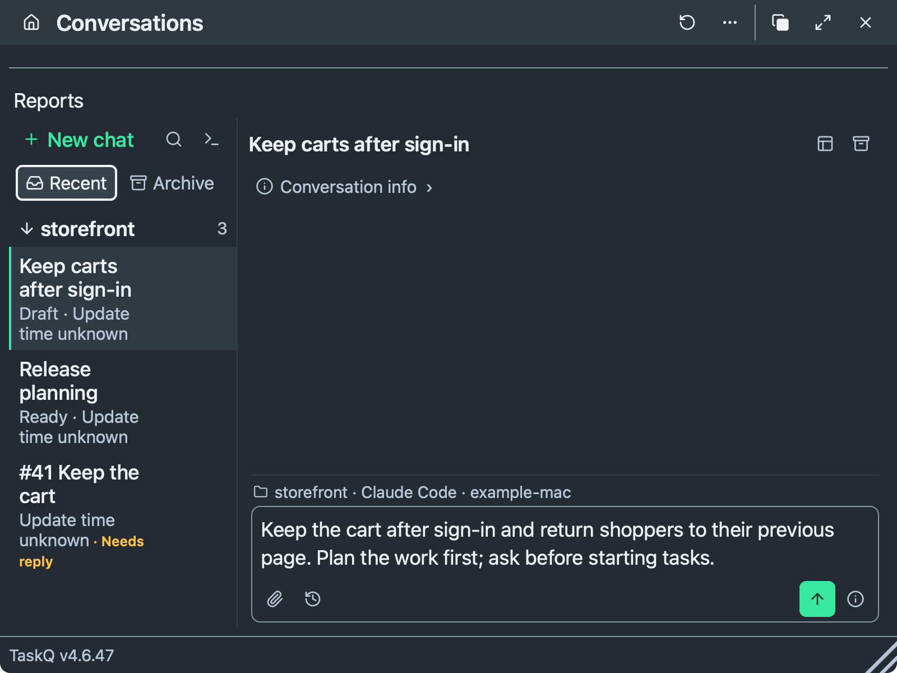
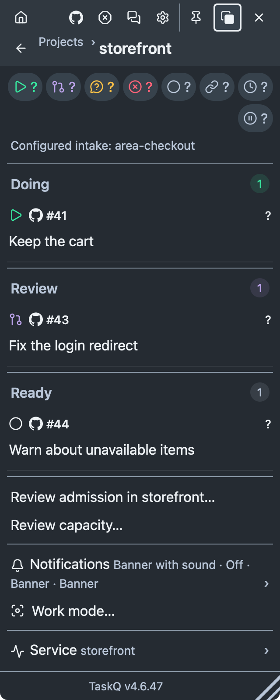
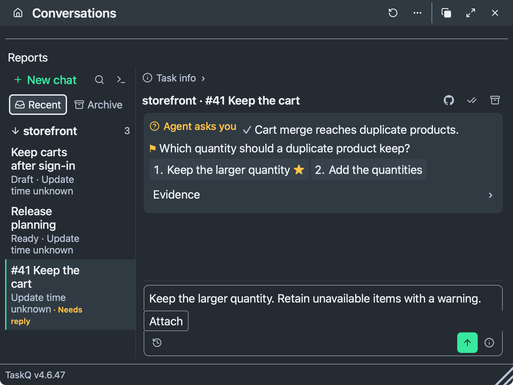

<p align="center">
  
  <br><em>Agents working.</em>
</p>

### Install

Paste into Claude or Codex:

```text
Install taskq from https://github.com/taskqorg/taskq and set it up for this project.
```

The agent confirms setup changes, installs TaskQ and connects your project board.

<details>
<summary>Starting a new project?</summary>

```text
Install taskq from https://github.com/taskqorg/taskq and create project <name> from <idea or folder>.
```

Replace `<name>` and `<idea or folder>` with your project.

</details>

Describe the work. Agents do it, a reviewer checks it, and you follow progress in TaskQ.

### 1. Describe the work

Write a request in Conversations or your usual Claude or Codex chat. Agree the plan before starting tasks.

<a href="docs/shots/popover-dark-conversations-owner-18.png"></a>

### 2. Follow progress

Tasks live as GitHub or GitLab issues. See what is running, under review or ready from the tray.

<a href="docs/shots/popover-dark-project-16.png"></a>

### 3. Answer a question

A worker waits when it needs your decision. Pick an answer or write your own.

<a href="docs/shots/popover-dark-conversations-question-18.png"></a>

*Real TaskQ interface with illustrative data; the request is an unsent draft. Open any image at full size.*

<details>
<summary>Prefer commands?</summary>

Run these in your project folder, or ask an agent to run them. Task #41 is the illustrative example above; use your own task number.

```sh
taskq status       # See the queue
taskq start 41     # Start an agreed, held task
taskq answer 41.1  # Pick option 1 on its current question
```

</details>

[Setup, commands and project rules](taskq.md).

<details>
<summary>Verify a downloaded release</summary>

Check the file against the release's `SHA256SUMS`, then verify its build provenance:

```sh
shasum -a 256 -c SHA256SUMS --ignore-missing
gh attestation verify <file> --repo taskqorg/taskq
```

Replace `<file>` with the downloaded release file.

</details>

License: [MIT](LICENSE).

If taskq saves you time, [buy me a coffee](https://alex.kirs.online/donate).
