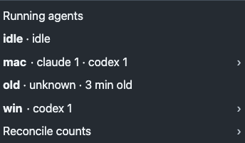
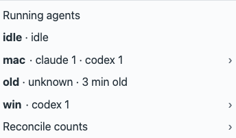
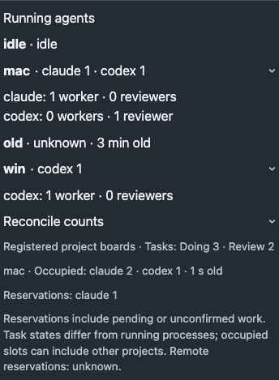
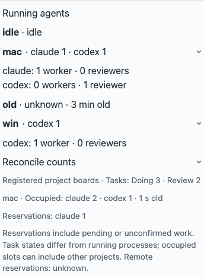

# Running agents menu block

Candidate implements #1349 and owner answer 1 under amended R6/M3. Home shows observed running agents by host/runtime; expansion separates workers and reviewers. Reservations and occupied slots stay separate from task-state totals. Owner layout approval is pending (A4).

## Verification

Source: `261aea8572af249da1600361c43587ec0dc86236`; subsequent changes contain evidence only.

- Before: `node tests/tray-running.test.cjs` failed because the running-agent renderer did not exist. After: passes host/runtime/role counts, stale/incomplete/malformed observations, reservations, duplicate boards and escaped names. A capacity refresh cannot freshen an old task observation: the check includes `tasks_age_seconds`.
- All 19 `tests/*.test.cjs` checks pass on the candidate.
- `python3 scripts/check.py --base origin/main`: FAIL, 73.975 s on this warm macOS worker; 403 passed, 18 failed, 34 ignored. The execution-heartbeat, status golden and native tray-adapter checks pass. Explicit host installation, policy and lifecycle worker refusals are sandbox-blocked; other failing assertion causes remain unknown. No permission or worker-environment bypass was used. Merge-group CI remains required and unverified.
- `TASKQ_SELFTEST_OFFLINE=1 cargo +stable run --locked -- selftest`, in an isolated temporary installation: 85 golden traces and formats PASS; telemetry committed three observations; board unknown because offline.
- `node docs/design/evidence/1349/capture.cjs`: real bundled tray, invented data, safe headless browser, no native bridge or board effects. See `observations.json`.
- `cargo +stable run --locked -- tray --snapshot <temporary-output> --route home`: signed macOS WKWebView, invented temporary installation, both themes at 16/20 px. Source and binary identity: `native.json`. All four Home images were generated; dark 16 px and light 20 px were visually inspected. New rows are visible and unclipped. Existing Home overflow at 20 px uses its scroll area; no full-route sizing acceptance is claimed.
- README shots were refreshed from the same signed debug build using `docs/shots/fixture.sh`, the workspace fixture with canonical physical roots, and the project/icon/workspace snapshot routes. Project and workspace retained their rendered content; this is not a release deployment.

The new Rust assertions initially expected Codex in a Claude fixture and raw task equality despite the existing `local_session` annotation. Both test defects were repaired: runtime must remain Claude, execution metadata must survive unchanged, and the local-session annotation remains asserted. Existing fencing, stale, malformed, trust and terminal-state assertions remain. The status golden only adds role/runtime metadata; no previous expected value was weakened. The adapter test failed before its fixture correction and passed in the final gate.

## Owner review

Approve the compact host rows and expanded details in both themes before merge (A4). Native images qualify the fixture render, not an installed service, live-board counts, Windows WebView2 or native interaction. No admission, permission or lifecycle policy changes.

Native Home: [dark 16 px](native-popover-dark-home-16.png), [light 16 px](native-popover-light-home-16.png), [dark 20 px](native-popover-dark-home-20.png), [light 20 px](native-popover-light-home-20.png).
