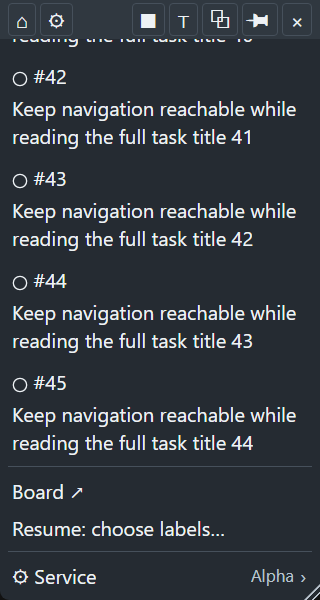
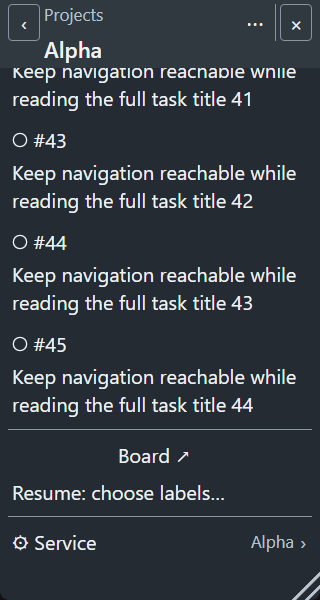
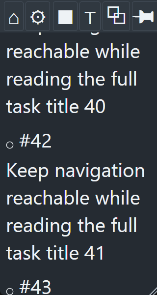
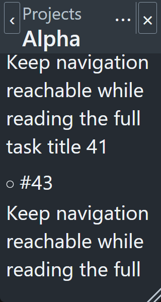
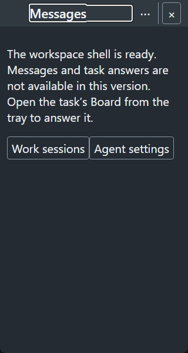
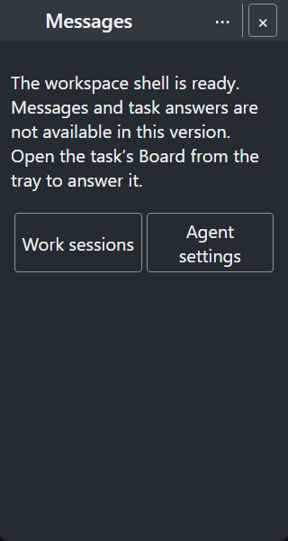
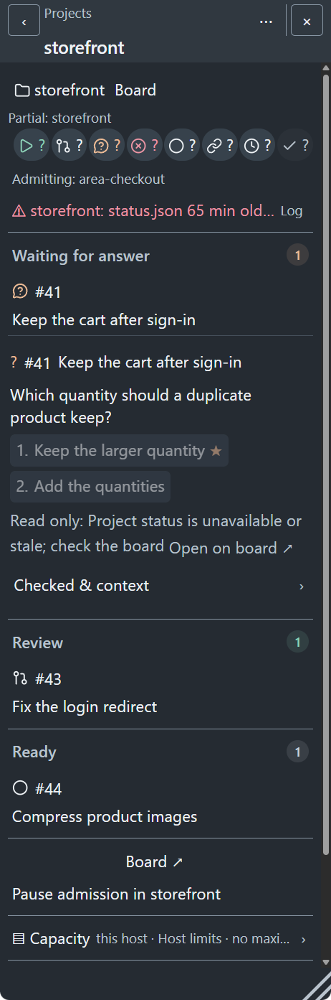

# Actual-size review set

Seven images, no scaled collages. Browser images are 320 CSS px at DPR 1.
The native image retains its captured physical pixels; those units are not CSS px.
Fixtures are invented. The owner accepted the rest of the set. Review only the
four refreshed after-images below for heading focus and parent-only breadcrumbs
([owner steer](https://github.com/taskqorg/taskq/issues/1463#issuecomment-6315125709); A8/V38, R12).
[Previous set for comparison](https://github.com/taskqorg/taskq/blob/0dd5589019061b4f0755709efe666d8327a8f262/docs/design/evidence/1463/screenshots.md).

## G01 before: Back leaves the scroller

## G01 after: Back stays in the fixed bar

## G02 before: Close clips at 200% text

## G02 after: essential Back and Close remain reachable

## Workspace before: route controls touch

## Workspace after: shared option spacing

## Native scope: Windows WebView2 project route, 16 CSS px

Development capture through Cargo, not installed or new-workspace qualification.
Source/binary hashes: [receipts](artifacts.json). WKWebView is not tested.

