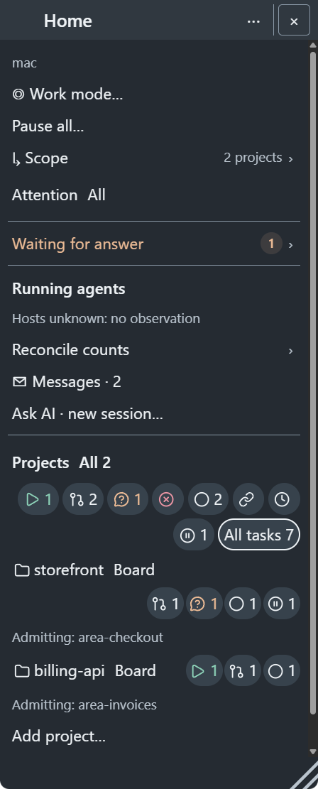
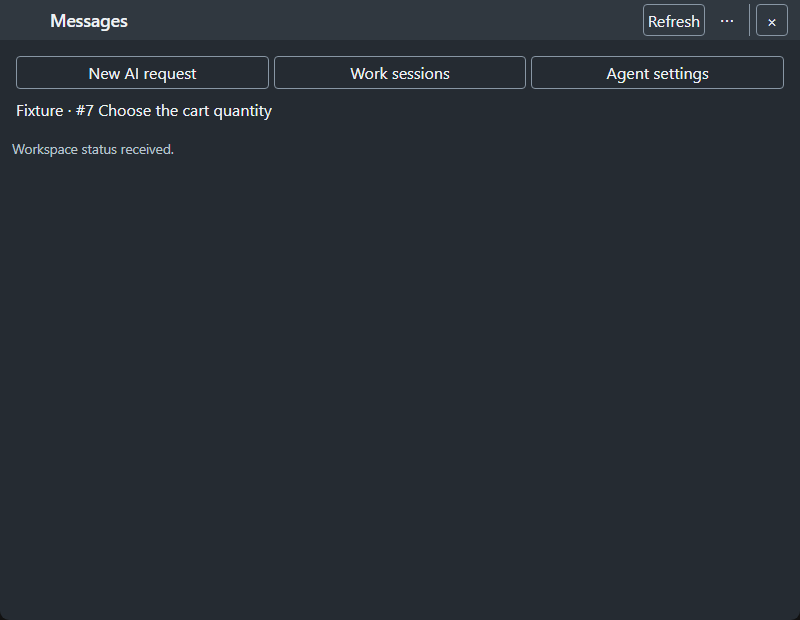
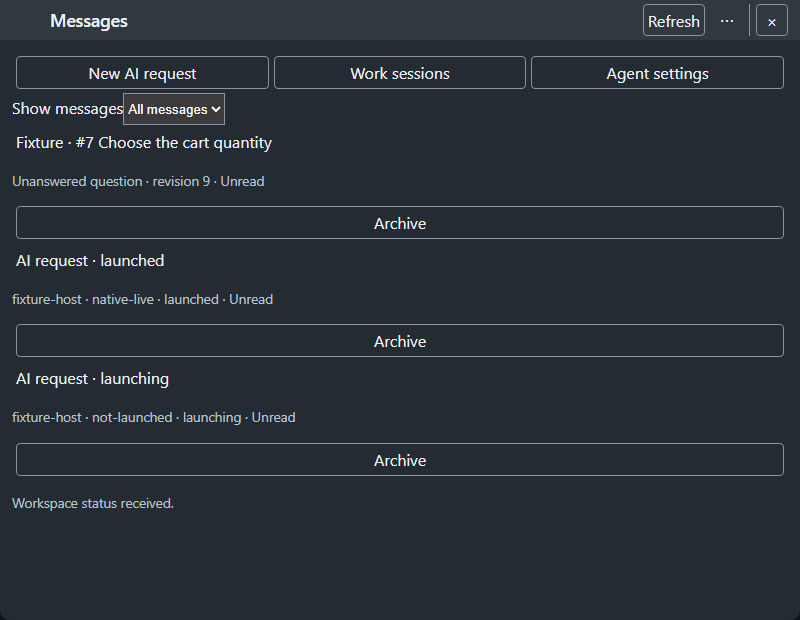
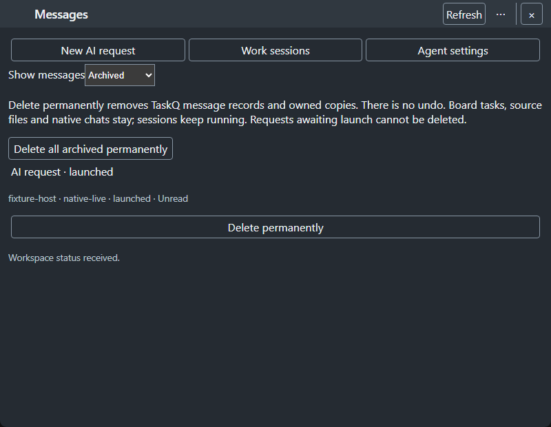
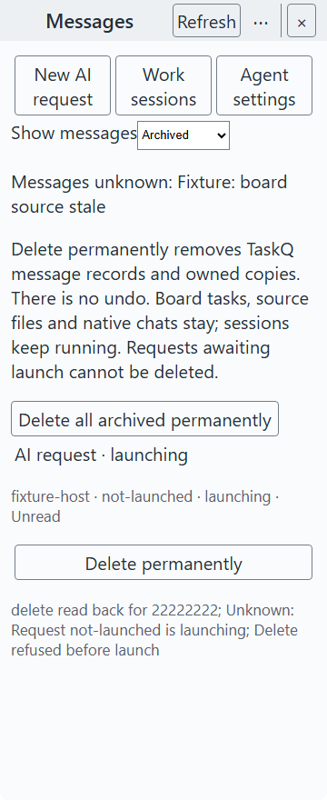

# Messages and permanent archive deletion · #1467

This candidate implements TW5–TW7 under the [owner's message-only answer](https://github.com/taskqorg/taskq/issues/1467#issuecomment-6320097999). Native chats remain native, pending/launching requests refuse deletion, and #1464's attachment handoff deferral remains. No board write, worker cancellation, runtime fallback or permission change is added (R1/R9/R11/R12/R13, § 7).

The owner [accepted M's seven-image layout and message-only scope](https://github.com/taskqorg/taskq/issues/1467#issuecomment-6328516821), reviewed at `bf2a6f2324cd4e6476ecc87ef38760b8cdeac7e1`. Combined #1465/#1466 and native workspace qualification remain separately gated work. Refreshed captures after rebasing retain that message scope; inherited operation-review changes are not qualified by this acceptance.

## Windows merge-queue investigation (R12, § 7)

[Merge-group run 39694561826](https://github.com/taskqorg/taskq/actions/runs/39694561826), candidate `f9d2a7caab16d3ae1691179a011455865789cc13`, passed Linux, macOS and Windows GNU. Windows MSVC passed all 501 unit tests (466 passed, 35 ignored), then exhausted the unchanged 900s gate in `telemetry_process::emergency_state_survives_failed_wakeup_and_notifies_other_projects`. The log names no stalled internal phase; this is not evidence of a message-deletion failure or its absence.

Before the fixture repair, the unchanged focused test passed locally on Windows GNU in 3.26s, and integration passed 18 tests with one ignored in 16.61s. The CI stall was not reproduced. An MSVC attempt could not build because `link.exe` is unavailable; local GNU results do not qualify MSVC.

The fixture now reuses CoreQ's bounded process exchange (60s per Windows CLI invocation, 10s elsewhere) and prints timings around Hold/Release, reader open, export and cleanup. Expected nonzero CLI exits still reach every original hold-state, notification and durable-error assertion. After this change the same focused test passed in 2.43s, including all three expected refusals and durable readback. No assertion, production behavior, dependency, authority check or gate budget changed (§ 7.4). The original CI stall's cause remains unknown; merge-result CI must still pass.

Tested fixture blob: `02aaf92656411d9b59dc42f136a6fb9241fbe2c3` on parent `a6a89123eca5437a951c79ae28191f131d976678`, already based on main `0128d46faeb25b6c49cd7418582b25755f4f9f1a`. The message implementation, UI sources and accepted images are unchanged in this repair; no new native/owner acceptance is claimed.

`python3 scripts/check.py --base 0128d46faeb25b6c49cd7418582b25755f4f9f1a` ran once on Windows GNU: 447 passed, 19 sandbox-blocked worker-authority refusals, 35 ignored; 57.516s. All nine message-boundary tests passed. This is not a passing canonical gate; no authority environment or guard was removed. The runner stopped before integration/Node/selftest, so those ran separately: `cargo +stable test --locked --test integration` passed 18 with one ignored in 19.01s; isolated `TASKQ_SELFTEST_OFFLINE=1 cargo +stable run --locked -- selftest` passed 97 traces, formats and nine staged observations (no board read); all 18 `tests/*.test.cjs`, screenshot manifest/script checks and release-script checks passed. No new browser or native captures were needed for this test-only repair; prior accepted rendering evidence remains historical. Merge-result CI is unknown, not a pass.

## Previous Mac repair (R12, § 7)

Candidate `04c62745` rebases the accepted message-only implementation onto main `0128d46faeb25b6c49cd7418582b25755f4f9f1a`. The conflict resolution keeps #1466's current Home panels and complete task list, replacing its Messages placeholder with the native snapshot badge. The following Windows results remain historical evidence, not current Mac qualification.

The new `interrupted_metadata_stage_does_not_block_the_next_write` regression failed before the repair (`unknown` instead of `accepted`). After the repair all nine Mac message tests pass, including partial-stage restart, committed-state preservation, hard-link target preservation, symbolic-link refusal, aliases, partial deletion and late-callback suppression. The hard-link check now accepts safe unlink/recreation while retaining its original source-byte assertion; it never permits writing through the link. No authority, prelaunch, containment or live-work protection was removed (§ 7.4).

The bundled Messages, request/answer, operation-review and Home-panel browser instruments pass on macOS Chromium headless shell. Visual inspection of the current Messages list and narrow 360 px/20 px partial-delete screen finds the required controls and readable unknown/refusal text without horizontal clipping. Platform font pixels differ from the accepted Windows images; those historical images remain the owner-accepted layout reference. Browser checks do not qualify native workspace operations or owner acceptance. All Node component/IPC checks pass.

`python3 scripts/check.py --base 0128d46faeb25b6c49cd7418582b25755f4f9f1a` ran once at `04c62745d5020b05703d7cf01552dc94bfce45f6` on macOS (cold build cache): 455 passed, 18 sandbox-blocked worker-authority refusals, 34 ignored; 84.253 s. The worker cannot install, restart/Stop or change host policy; the guard also makes the project-overlay fixture return `unsupported`. No authority environment was removed. This is not a passing full gate.

`cargo +stable test --locked --test integration`: 19 passed, one sandbox-blocked (`telemetry_process::resume_records_its_result_without_releasing_the_host_hold`: `sandbox-exec: sandbox_apply: Operation not permitted`), one ignored; 7.89 s. Isolated offline selftest passes 97 golden traces, formats and nine staged telemetry observations; no board read. All Node component/IPC checks and screenshot/release-script checks pass independently because the canonical runner stopped at its blocked Rust tests. Green merge-result `merge_group` CI remains required; the worker does not wait (§ 7).

`docs/shots/update.sh` and an isolated Home snapshot pass on macOS 27.0.1 arm64 WKWebView from the same candidate. Visual inspection confirms the project/task layout and `Messages · 2` alongside the incoming Home panels; unknown process counts remain explicit. Source blobs and image hashes read back against the manifest. This is native rendering evidence, not live workspace deletion or owner acceptance.

## Acceptance and retained protections

| Item | Evidence and limits |
|---|---|
| A1 | The tray Messages count and workspace consume the same native snapshot. Eight Rust message-boundary tests cover duplicate board questions, read versus unanswered, new revisions, unread launch outcomes, archive exclusion, corrupt input and stale sources reading unknown. The badge adapter retains explicit unknown/count checks. |
| A2 | The real bundled browser opens existing records with only a local read mark; no send or answer is dispatched. Back retains filter and invoker focus; restart retains the filter, and composer drafts survive archive. The existing workspace communication instrument retains draft/caret, IME, Shift+Enter, same-ID recovery and answer-revision coverage. Attachments stay deferred; browser events do not qualify physical IME or native session behavior. |
| A3 | Any request state and unresolved question can be archived without a process action. Archived source identities remain accessible after a launch state change or board answer, without copying board text or native replies. A new outcome/revision has its own identity. |
| A4/A5 | Native deletion removes only an archived owner's request record, temporary write copy and owned setup folder. Questions lose local metadata and keep only a content-free suppression digest; the board stays authoritative. Request-ID digests prevent stale clients from launching deleted work again. Tests preserve source/native markers, refuse Windows junctions and prelaunch states, and verify owned-path absence. This is model/filesystem evidence, not a live Claude turn qualification. |
| A6 | Real filesystem tests cover failed/partial deletion, fresh-store readback, archive aliases, metadata corruption, interrupted launch recovery and a late callback. The same setup lock serializes launch and deletion. Each Delete all item receives its request's verified outcome. Unix symlink coverage is retained in the same module but is not run by this Windows host. |
| A7 | Archive, permanent delete, Close workspace and command history are separate controls. The browser checks keyboard Enter/Back/Escape, no resend/cancel/history-clear effects, unknown feedback and a narrow 20 px view. Request/answer receipts and drafts keep their existing adapter. |
| A8 | The four browser images below show before/after, archive consent and narrow unknown/partial states. The instrument also checks the reachable last action and fixed navigation in a 360×640 window; the narrow review image uses 360×880 to frame all feedback. Native captures are separate; the owner accepted this seven-image layout, while native workspace qualification remains separate. The combined seven-point review below records unfinished owning tasks explicitly. |

## Before and after

- Before `node tests/tray-home-ai.test.cjs`: failed because the Messages badge renderer was absent. After: the same check passes with count, destination and unknown reason assertions.
- The first browser implementation could not dispatch Read because `crypto.randomUUID()` was unavailable in the renderer context. The existing `getRandomValues` pattern fixes it; the message browser instrument passes opening without resend, Back/filter restoration and archive/delete feedback.
- Both safety-review regressions failed before their fixes: an existing `messages.tmp` hard link was accepted, and two archived states of one request produced a false unknown receipt. After: all eight message tests pass. Exclusive temporary-file creation preserves linked targets; one deletion result covers each selected alias.
- The staged-history assertion also failed before deletion removed `setup/<id>.tmp`. After: the same test verifies the temporary brief copy is absent as well as the main record and folder.
- R7 receipt wording: the browser assertion failed on `archive read back for 22222222`. After: the same assertion passes with `Message archived`; read/delete use plain action labels too, while per-item refusal reasons remain visible.
- The publication budget test failed with two extra issue reads on the other host. Its shared `/nonexistent` installation allowed unrelated profile rows into the test. A unique temporary installation fixes the failure while retaining every exact read-count assertion. The focused test passes.
- Before rebasing, the corrected full gate reported **sandbox-blocked**: 444 passed, 19 worker-authority failures, 35 ignored. The final combined candidate rebases onto `7cc123790fd1fd5612a112fb05abe3c777840f09`, retaining the incoming CoreQ fix and shared task controls. `python3 scripts/check.py --base 7cc123790fd1fd5612a112fb05abe3c777840f09` took 68.453 s on this Windows GNU host: 444 passed, 20 failed, 35 ignored. Nineteen failures remain worker-authority refusals; `runtime::app_control::tests::cancellation_is_owner_bound_bounded_and_never_replays_work` failed with a native broken pipe. An earlier rebased full run timed out in the native pipe-bounds fixture, which passed alone. These full-run native failures remain open; no deadlines, assertions, worker identity or authority guards were weakened. Merge-result CI remains required (R12, § 7).
- After rebase: all Node component/IPC checks, both affected browser instruments and screenshot/release-script checks pass. Integration: 18 passed, 1 ignored. Isolated offline selftest passes: 97 fold traces, formats and staged telemetry commit only; it reads no board and does not establish live board health.
- Check identity: the full Rust gate, integration and offline selftest above ran at `8f91dcb6c6209ced681bc3d3239f3c735d99f0c5`. The subsequent `a0c1db68d5dd35ddaced64b8fbfe60507677a2e4` change only replaces receipt wording; its affected browser/badge checks and refreshed native captures pass. Rust behavior, tests and dependencies are unchanged. Later evidence commits change documents/images only; the final publication SHA still requires CI.
- Accepted-scope rebase: `072b43204eccc99e5246b82e6998dec0d0dab11d` includes main `4dfa99625f1c6f821e834c20762a48a66eb95f08`, including #1465's operation routes and the updated CoreQ writer. `python3 scripts/check.py --base 4dfa99625f1c6f821e834c20762a48a66eb95f08` took 168.640 s on this Windows GNU host: 446 passed, 19 failed, 35 ignored. All nineteen failures are worker-authority refusals (`sandbox-blocked`); all eight message tests passed. The earlier native cancellation-pipe failure did not recur in this run; that is not proof of eliminating its intermittent risk. No worker guards or assertions were weakened. Merge-group CI remains required (R12, section 7).
- At that same revision, all Node component/IPC checks and the message, request/answer and inherited operation-review browser instruments pass. The message images remain byte-identical to the owner-accepted set. Screenshot/release script checks pass. The rebase preserves operation routes, input handling and navigation state alongside message routes and filters; it does not establish combined native qualification.
- At `072b43204eccc99e5246b82e6998dec0d0dab11d`, `cargo +stable test --locked --test integration` passes: 18 passed, 1 ignored (18.50 s). Isolated `TASKQ_SELFTEST_OFFLINE=1 cargo +stable run --locked -- selftest` passes 97 traces, formats and nine committed staged observations; the board remains explicitly unknown because this check reads no board. Neither result removes the full-gate sandbox limitation.
- Native Windows capture: the direct GNU executable invocation exited 127; running the same release through Cargo passes and preserves its build loader environment. `docs/shots/update.sh` now supports Windows paths/metadata and keeps Cargo's configured macOS signing runner. Rebased native captures passed on Windows; macOS was not rerun here. The separate Home capture uses invented source files, shows `Messages · 2`, and launches no session.

Refreshed Windows WebView2 Home/project/icon captures come from `072b43204eccc99e5246b82e6998dec0d0dab11d`; their source blobs, binary and image hashes read back correctly. The four message browser images remain identical to the accepted `bf2a6f2324cd4e6476ecc87ef38760b8cdeac7e1` set. Inherited #1465 launchers are visible in the new native captures, while their combined acceptance remains separate. The final evidence commit changes only prose, hashes and native images; code, tests and dependencies remain the tested source above.

The local metadata writer discards an interrupted regular `messages.tmp` under the setup lock, then creates a fresh exclusive staging file. It never applies staged bytes over committed marks or writes through a linked target. A symbolic link, directory or failed cleanup remains unknown. The restart regression fails before this repair and passes after it; the linked-source byte-preservation assertion remains, while a hard-linked stage is now safely unlinked rather than blocking every later write. Deleted message history has no undo, trash or retained content copy; command history and drafts remain distinct under the approved boundary.

## Combined seven-point review

| Owner point | Current result and owning task |
|---|---|
| 1 — navigation | #1463's shared fixed bar remains in both windows. Messages is a root with no cross-window Back. Message details use Back and restore the list's filter/focus. |
| 2 — dialogue placement | #1464 supplies workspace requests and task answers. Operation reviews now arrive from #1465 on main; their combined acceptance remains separately gated by the owner answer. This candidate retains those routes alongside messages. |
| 3 — panels before tasks | Main now includes #1466's panels before the complete task list. This repair retains that composition and its browser assertions; combined native/owner acceptance remains separate. |
| 4 — other content | Messages and archive live in the workspace; native replies remain in Claude/Codex by the accepted scope. Existing Work sessions/Agent settings fallback screens still name the tray destination; this task does not implement those separate screens. |
| 5 — messages/archive/delete | Implemented with stable identities, explicit unread/unknown handling, archive-any, archived list, permanent one/all deletion and the prelaunch refusal. |
| 6 — whole-surface review | Source/route review completed; M's seven-image layout is accepted; the owner explicitly kept combined #1465/#1466 visual/interaction acceptance separately gated. No synthetic fixture qualifies native workspace behavior. |
| 7 — interaction consistency | Existing source option IDs and direct-answer semantics stay in the shared answer card. Message list selection is a labelled select; actions use ordinary buttons, with no selected-action styling. Keyboard and receipt behavior are covered by the bundled browser instruments. |

## Visual review set

Seven-image set: four browser images, one native Home image and two native README images. Fixtures are invented; browser images use Chromium headless shell on Windows at actual CSS sizes without resizing. WebView2 images retain their captured physical pixels. The current Mac native binary and source blobs are recorded in `docs/shots/manifest.json`; `sources.json` separates current native images from the retained owner-accepted Windows browser images.

Current macOS native Home, including the Messages badge and incoming #1466 panels:

Native README [project capture](../../../shots/popover-dark-project-16.png) and [icon capture](../../../shots/icon-summary-run-dark.png). Before: [project](https://github.com/taskqorg/taskq/blob/2f6a2d2c9ac427f9687b64714bd2cfd21805773c/docs/shots/popover-dark-project-16.png), [icon](https://github.com/taskqorg/taskq/blob/2f6a2d2c9ac427f9687b64714bd2cfd21805773c/docs/shots/icon-summary-run-dark.png). Including those two earlier images keeps the review set at nine, below V38's cap.

Before, baseline `2f6a2d2c9ac427f9687b64714bd2cfd21805773c`:

After, Messages and pending outcomes:

Archived records and permanent deletion boundary:

Narrow unknown source and a refused prelaunch deletion; the content has one intended vertical scroll area:

