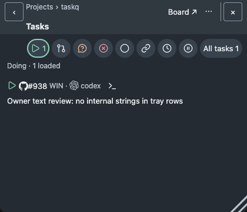
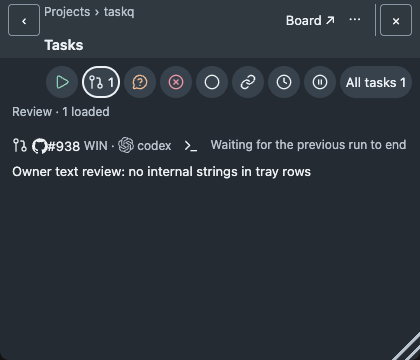
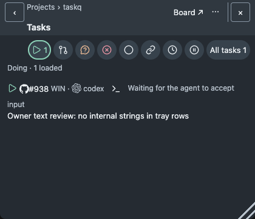

# Owner row texts · #1524

Tray and `taskq status` task rows show only the owner texts named in [menu.md M3 Task row text](../../menu.md) (R6/R7, R13). Raw diagnostics stay in `status --json` (`execution_wait`, `executions`) and the service log.

## Text sources (A1)

| Source | Example raw text | Spec rule | Verdict |
|---|---|---|---|
| Execution status: admission or load gate | `launch held by admission gate` | M3 wait | Row: `Waiting for a free slot` |
| GUI eligibility (`gui_reason`) | `GUI unavailable on <host>: <reason>`, `GUI runtime <rt> refused: ...` | M3 wait | Row: `Waiting for GUI access` |
| Input acceptance (status, recovery, launch errors) | `native input acceptance pending`, `input pending on <host>; ...`, launch outcome unknown | M3 wait | Row: `Waiting for the agent to accept input` |
| Owner answer | `owner answer required` | M3 wait, R7 | Row: `Waiting for your answer` |
| Termination, cancellation, handover, multiple executions | `execution <id> on <host>: termination unconfirmed`, `cancellation pending; ...` | M3 wait | Row: `Waiting for the previous run to end` |
| Missing, stale or unknown observation | `native observation unavailable`, `... deferred; recovery budget exhausted`, `recovery unknown: <e>`, `session identity unknown` | M3 wait | Row: `Run state unknown; see service log` |
| Any other `execution_wait` text | (future producers) | M3 wait | Row: `Waiting for the previous run to end`; raw text log-only |
| Session reason (`tray.rs`) | `Codex session opens only on <host>` | M3 session | Kept as title of `Session unavailable` |
| Status session cell | `<host>: starting`, `<host>: running`, `<host>: Remote Control unknown` | M3 session | Kept |
| Tray Running agents host line | raw execution `reason` | M3 | Fixed `Run state unknown; see service log`; raw reason log-only |
| Dependency reasons | `blocked (...)` | R6 | Kept |

## Screens (A6)

Browser-rendered `build/web/tray.html` (instrument, not native proof); the raw text in each fixture row is asserted absent.

| Doing | Worker-to-reviewer handover | Waiting |
|---|---|---|
|  |  |  |
