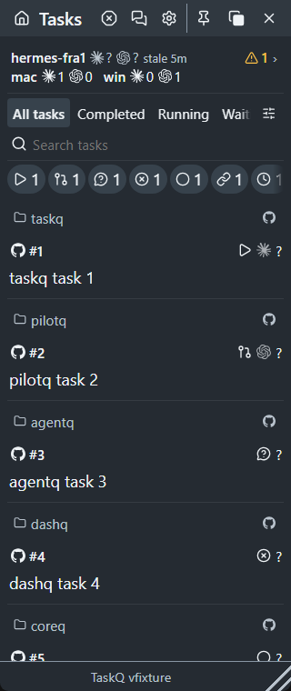
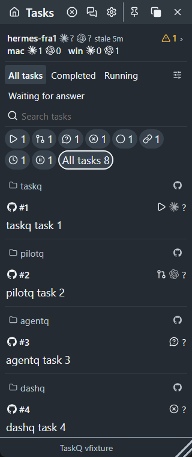

# Menu filter wrapping — #1709

R13 records the owner's wrapping decision in `taskq.md` and [M3](../../menu.md#m3-navigation-and-tasks) before implementation. R12 and § 7 require a failing reproduction and a pass on the changed candidate. The former #1701 one-line/260 px assertions are superseded; host identity, stale counts, whole host chips, Attention placement and unchanged text size remain protected.

## Browser evidence

Command: `npm run build`, then `node tests/menu-host-strip.browser.cjs` with the documented Playwright setup. Windows, Node 24.5.0, Chromium headless shell 156.0.8078.4; synthetic fixtures, 1× scale. This checks the bundled product HTML, not a separate mock.

Before: `aa7319c32107e109d9db337c26e93cd4682836f3` stylesheet with the same fixture and updated check, exit 1 at 320 px / 18 px / dark:

| Element | Available width | Content width | Horizontal overflow |
|---|---:|---:|---|
| View picks | 268 | 369 | auto |
| State counters | 304 | 449 | auto |

After: all eight width/font/theme cells pass (320/360 px, 16/18 px, dark/light). Each checks wrapping, all eight states plus All tasks, complete chips, no mask, unchanged text size and every rendered element for `scrollWidth > clientWidth` or horizontal `auto`/`scroll`.

The same overflow check covers task details, the populated View window, Settings, Appearance, Hosts and resources, Delivery, Activity history, Notifications, Agents, Services and About. It also exposed and protects the fixes for horizontal scrolling in task details, clipped service labels and the history disclosure marker extending past its row.

The two images below use the same 320 × 760 px viewport, 18 px text and dark theme. No other matrix screenshots are retained.

Before:

After:

## Limits

Browser evidence does not qualify native macOS rendering, Windows DPI variants or live host effects. README snapshots and their manifest are refreshed separately under § 7 rule 4. No service deployment or capacity change is part of this task. Merge-result CI and reviewer/owner acceptance remain separate under R12 and § 7.

## Candidate checks

- `python3 scripts/check.py --base aa7319c32107e109d9db337c26e93cd4682836f3`: **FAIL**, 529.781 s. Rust unit tests: 524 passed, 19 failed, 36 ignored. Eighteen host-policy/lifecycle/resource/sandbox cases reach worker/operator restrictions (`sandbox-blocked`); the worker environment and restrictions were preserved. `core::tests::every_table_row_has_a_golden_trace` passes, including R8's contract bounds.
- The nineteenth failure is `runtime::app_control::windows_pipe::tests::native_pipe_bounds_unread_writes_and_empty_reads`: IPC deadline under parallel load. `cargo +stable test --locked --bin taskq runtime::app_control::windows_pipe::tests::native_pipe_bounds_unread_writes_and_empty_reads -- --exact` passes alone (0.20 s). This does not erase the parallel failure or qualify that timing risk.
- The canonical gate stops at the Rust failure. Its remaining Node/component, artifact-script and changed browser checks were run separately. The source-manifest check first failed on the changed stylesheet; `node tests/task-workspace.test.cjs --write` refreshed that hash, retaining the released-asset protection. Those checks then pass, including all eight wrapping cells.
- `cargo +stable run --locked -- selftest`: **PASS** with an isolated installation and `TASKQ_SELFTEST_OFFLINE=1`; formats and staged telemetry pass, board read remains unknown by design.
- `cargo +stable test --locked --test integration`: **PASS**, 17 passed, 1 ignored (16.69 s).
- `docs/shots/update.sh`: **PASS**, isolated Windows/WebView2 project/icon snapshots from `8bb655ebec1777595383656b444821ed04452c94`; inspect [manifest](../../../shots/manifest.json) for source/blob/binary/image identities. The later source-manifest/report changes leave UI source bytes unchanged.

The local canonical gate is not green. Merge-result CI remains required under R12 and § 7; no restriction was removed to obtain a local pass.
