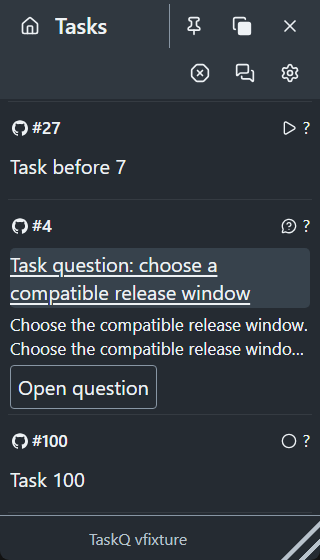

# Compact question attention — slice 2

Implements [#1740](https://github.com/taskqorg/taskq/issues/1740) against the approved
[M3 question entry](../../menu.md#m3-navigation-and-tasks) and the
[preservation ledger](../../exploration/conversations-preservation-audit.md).
R13: the accepted decision already exists; no R-number is amended.

Question rows keep a two-line source excerpt and **Open question** in the menu's
ordinary flow. At heights of 430 CSS px or less the excerpt yields to identity and
the direct action. Identity opens inline Pin, board, lifecycle and technical
details. Other tasks and view controls retain their anchored popovers. The action
uses the existing board/root/task/revision route without answering, acknowledging
or launching work. No public workspace export or schema changes.

## Before and after (R12, §7)

At base `3612d385fbcbc0d8c4b4c78f068c35cad2834319`, the new real-wheel check
in `node tests/tray-task-list.browser.cjs` failed: the menu content did not move
within 1500 ms while the pointer was over the long question's independently
scrolling popover. The pre-existing row journeys passed first. With the same
fixture after the fix, the menu moves in both directions over identity, title,
excerpt, action and all four preview edges, with no inner question scroll.

The fixture now supplies the current authoritative display model, row ranks and
partial-project names; old fixtures omitted them and failed before exercising
their intended journeys. Row order, lifecycle placement, Escape/focus return,
chip centering and fit-height protection remain. The existing Conversations
journey now locates the ask entry inline and still checks every other task entry
in its popover. Source hash refreshes retain the published-bundle parity check.

Browser evidence uses the real `build/web` product bundle and invented local
snapshots, Chromium headless shell 156 on Windows x64, scale 1. The bridge is
substituted; these checks do not qualify native effects. The representative image
uses 320×560 CSS px, 20px text and coarse-pointer targets. Matrix variants are
checked by script rather than added to the review set.

## Acceptance and preservation

| Requirement / ledger groups | Regression journey and observed result |
|---|---|
| A1 / M15 | `tray-task-list.browser.cjs`: Pass. Real browser wheel input with 90px and 12px deltas in both directions over identity, title, summary, action and preview edges. Large wheel gestures still reach the last row and return to the top. No `scrollTop` assignment drives these checks. Physical trackpad: Not tested. |
| A2 / M16 | `tray-task-list.browser.cjs`: Pass for exact board/root/task/revision dispatch, unchanged query/view and scroll within 2 CSS px on refresh/return. `conversations-selection.browser.cjs`: Pass for actual task-thread selection, source choice IDs and no implicit task/owner writes. Native window Back/raise: Not tested. |
| A3 / M01–M05, M07–M08 | `task-dashboard.browser.cjs`: Pass for saved views, scoped counters, project selection/deduplication, grouping, search, Save/Reset, custom-view deletion/Undo and Completed history/retry. View editor and Saved views still use their existing popovers. |
| A3 / M06, M09–M14 | `tray-task-list.browser.cjs` and `task-dashboard.browser.cjs`: Pass for ordinary task popovers, Escape focus, inline question controls and task Pin/Unpin. `project-blocks.test.cjs`, `task-controls.test.cjs`, `tray-answer.test.cjs`: Pass for safe board/session destinations, sourced state controls, exact operation/revision, refusals and same-ID recovery. No authority or dispatcher changes. |
| A3–A4 / M17–M20, M22, M25 | `menu-host-strip.browser.cjs`: Pass for preserved menu/View/Settings controls and wrapped host/count chips at 320/360px in both themes. `tray-task-list.browser.cjs`: Pass for fixed header/footer, existing 32px/44px targets and question context. Native drag, resize, pin/top and OS theme effects: Not tested. |
| A4 / Q-A10 menu | `tray-task-list.browser.cjs`: Pass at 320/360 CSS px, 14/16/18/20px text, both themes, including a long unbroken title and long source question/choice. Relevant container and button widths reflow without horizontal overflow. At 430px height the excerpt disappears and the direct action remains. |
| A5 / X01–X03 | `task-workspace.test.cjs`, `tray-home-ai.test.cjs`: Pass for public schema, source hashes, identical tray/release bundle bytes and shared workspace-mode task rows. DashQ deployment: Not tested; no deployment performed. |
| A5 / X05 | Native macOS/WKWebView and Windows/WebView2 interaction acceptance: **Not tested**, reserved for slice 5. README Windows snapshot capture is separate image evidence, not gesture or lifecycle qualification. |

An additional `shell-navigation.browser.cjs` probe fails G02/V23 at 320px with
40px text (200% of 20px), identically with the unchanged base bundle and this
candidate. It is outside this slice's 14–20px matrix and remains an advisory;
this slice does not change the shell. Canonical candidate checks are recorded
in the PR and TaskQ result. Merge-result CI and owner acceptance remain pending.
