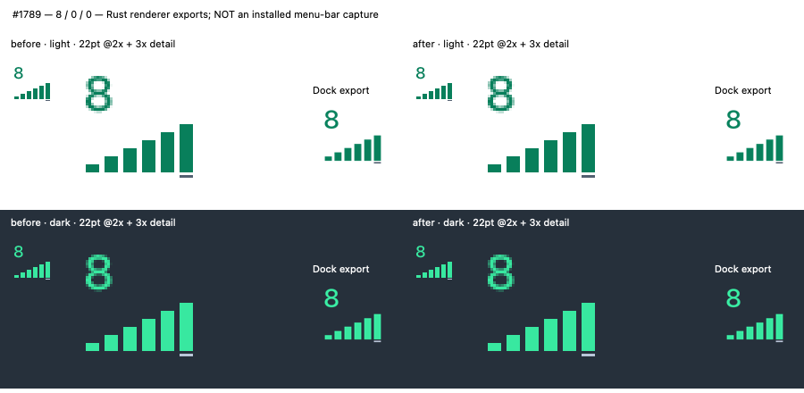
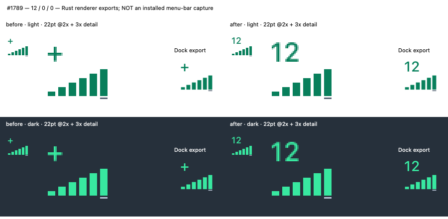
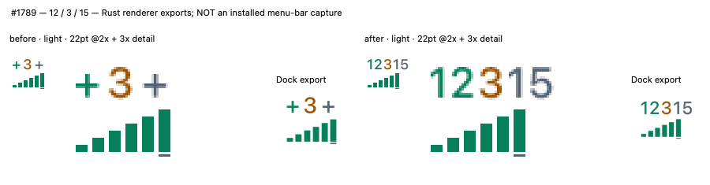

# Exact Summary counters · #1789

R13 amends Product and [I1/I2/I5](../../icon-summary.md); M1 links the revised fitting rule. R12 and §7 distinguish renderer checks from installed/native acceptance. The baseline is `6a97fc111c428213c136f2b54a35f9214586334c`.

The fixed 5.6 pt cells replaced two digits with `+`. Both native-font implementations now return measured ink. The shared layout reclaims hidden-zero cells, then expands the Mac menu-bar canvas only when needed. Dock and Windows retain square canvases containing the complete SVG. The chart, palette, unknown dash, zero hiding, compact fallback and pause policy remain protected.

## Before and after

A temporary Cargo example compiled the baseline `src/icon.rs` and candidate renderer against the same locked dependencies, without the service or board. At 9 pt SF Medium, the first counter for 10 or 12 was a 4.761406 pt plus. Afterward, 10 measures 9.19878 pt and 12 measures 8.890751 pt. A lone 12 keeps the 22 pt slot; 12/3/15 needs 27.613152 pt. Three capped counters use 55.484924 pt. These are logical renderer dimensions, not observed installed slot sizes.

The initial development test incorrectly treated the baseline as the bottom ink bound; SF numeral overshoot made its 9.01 pt assertion fail on a single digit. The corrected bound is the chart's first possible mark at y=10.5. The independent baseline/candidate instrument then confirmed the actual overflow defect above. No chart, font or overlap protection was weakened.

The three inline panels show original 2× rasters, nearest-neighbor detail and square Dock exports. All activity is synthetic. These are **canonical renderer exports, not installed menu-bar or Dock screenshots**. The native SF outlines are real; OS placement, translucency and presentation are not qualified.

Visually inspected all three panels, both themes, and the 256 px export with three `99+` counters. All digits and six columns are present; no counter overlaps another or the chart. Unaffected compact assets and the accepted six-column chart remain the reference.

## Acceptance

| Item | Result | Evidence |
|---|---|---|
| A1 specification and renderer | Pass | I2 changed first; exact 10–99, 99+ cap, measured cells and separate Mac/square raster paths |
| A2 counter matrix | Pass | `icon::tests::exact_two_digit_counters_reclaim_space_before_widening`: 0/9/10/12/99/100, each position alone and together, both themes, 22/44/256 px |
| A2 retained protection | Pass | Existing icon tests retain palette, six bins, unknown/zero, blocked aggregation, pause, compact resources and first-capture behavior |
| A3 installed Mac 8/12/12/3/15 | Not tested | The running TaskQ owns the one-app host lock. A second normal launch raises that app; this task did not replace it or restart active work |
| A3 Windows availability | Not tested natively | Square notification-area canvas is retained; target-specific execution and merge-result CI remain pending |

The counter matrix replaces the old oversized-count width ceiling, whose accepted behavior changed. Single-digit/unknown ink alignment remains checked. The new cap case compares 100 with the largest usize. The adapter check `tray::tests::two_digit_summary_uses_the_native_canvas` protects the Mac rectangle and Windows square selection and shared published/native SVG path; it does not create an OS status item.

Environment: macOS 27.0.1, arm64, SF system font Medium 9 pt; rustc/cargo 1.98.1, warm seeded dependencies. Source hashes and panel hashes are pinned in `manifest.json`. The source check and canonical gate receipts follow below.

- `cargo test --locked --bin taskq icon::tests`: 6 passed, 1 subprocess helper ignored; 19.23 s execution after the warm build.
- `cargo test --locked --bin taskq two_digit`: 2 passed, including cap and native-canvas checks; 3.14 s execution, 60 s warm rebuild.
- The temporary baseline/candidate export instrument confirmed the old single-plus signature and the corrected two-glyph ink for 10 in both themes; 8 stayed identical.

The expanded pause mask retains the original cleared Q region and also covers the extended canvas. A pixel check requires counter ink beyond the former 22 pt edge while paused, preventing a new clipping regression.

- `RUSTUP_TOOLCHAIN=stable sh docs/shots/update.sh`: passed from `de0f48ea`; the source-pinned README snapshot and icon export were opened and inspected. The project PNG is unchanged; the clock-dependent icon export was refreshed.
- `sh docs/shots/check.sh`: passed. This verifies source pins and capture files, not installed OS icon presentation.
- The first release build refused the inline dynamic-mask `write!` with `instrumentation changed source lines`. The equivalent multiline `push_str(format!(...))` form passed instrumentation and the release build; the mask geometry is unchanged.
