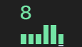
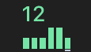
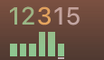
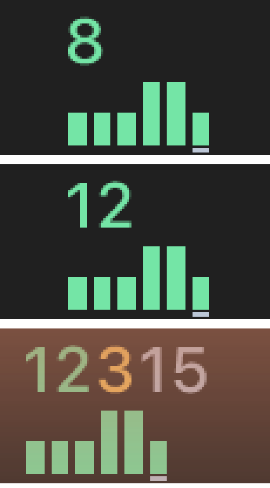

# Native Mac menu-bar Summary · #1789 (A3)

Candidate `8a839bcea33512b8c22a3dab2ffd23515c78d7c2` (PR #1791 head), release build of taskq 4.6.39 (`cargo build --locked --release` after `npm ci`; binary sha256 `8b27c521afe8477748db4ad959d2580d072f5dfe528ba4c93b7be0dc6c83c85a`). macOS 27.0.1, arm64, dark appearance, 2× display.

These are **native captures of the real macOS status item**, taken with `screencapture` from the menu bar. The files in the parent folder (`../8.png`, `../12.png`, `../mixed.png`) are renderer exports; they are a separate kind of evidence and are unchanged.

## Method

- Fixture: `TASKQ_VERSION=4.6.39 sh docs/shots/fixture.sh DIR`, then the storefront task list was replaced so the Summary counts are exactly 8 doing; 12 doing; 12 doing, 3 ask, 15 ready. billing-api had no tasks. `tray.json` set `"view":"full"`; `current` named 4.6.39.
- Each count ran its own `taskq tray` (not `--snapshot`) with an isolated `TASKQ_INSTALL` and a fresh `TMPDIR`, so the candidate took its own host lock beside the installed TaskQ. The isolated Open did not start a service (the fixture status has no pid). Each candidate process was stopped by its exact pid after its capture. The installed app and service were not touched.
- Screen capture permission was checked with `CGPreflightScreenCaptureAccess` only. No permission prompt or privacy setting was involved.
- The candidate item was identified by its presence/absence against a capture with no candidate running, then cropped at native 2× pixels. `zoom.png` is the same three crops at 4× nearest-neighbour.

## Results

| Count | Capture | Exact digits | No plus | No overlap | Result |
|---|---|---|---|---|---|
| 8 | [8.png](8.png) | 8 | yes | yes | Pass |
| 12 | [12.png](12.png) | 12 | yes | yes | Pass |
| 12/3/15 | [mixed.png](mixed.png) | 12, 3, 15 | yes | yes | Pass |

  

Notes:

- In 12/3/15 the three counters sit close together; they are separated by colour (doing, ask, ready), with no shared or clipped glyph. The chart keeps six columns under all three counts.
- The 12/3/15 capture has a tinted translucent menu bar (wallpaper behind it); this lowers contrast but does not change the glyphs.
- Not covered here: light appearance, Dock icon, Windows notification area, 99+ cap on a native status item.

| File | sha256 |
|---|---|
| 8.png | `a38553897512e8c5c02e589457115f77da9368c23282366761e8e78a160d3d46` |
| 12.png | `f196e67b75802e550d4e509e81fa0451e21d2c136a423de4ecaf4c61fb85930c` |
| mixed.png | `fcae0a722a11f613d251c2f8ebc6030f11dfceab3987ade17ec29bce9ab6a928` |
| zoom.png | `ce1659bbba56728bf2e8584cf3c62b76dfaa792d44ae5c63a82baaad818b446b` |
