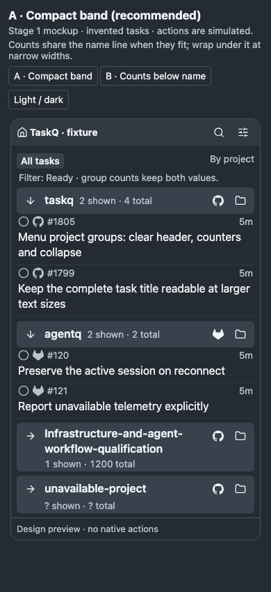
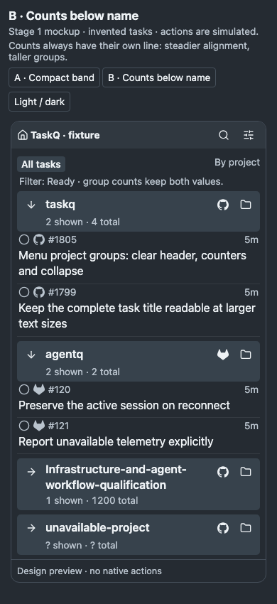
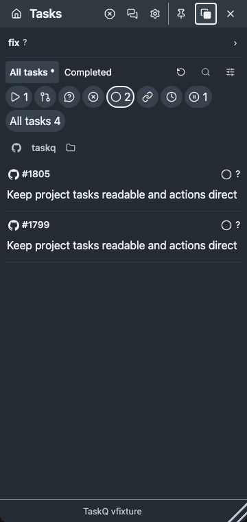
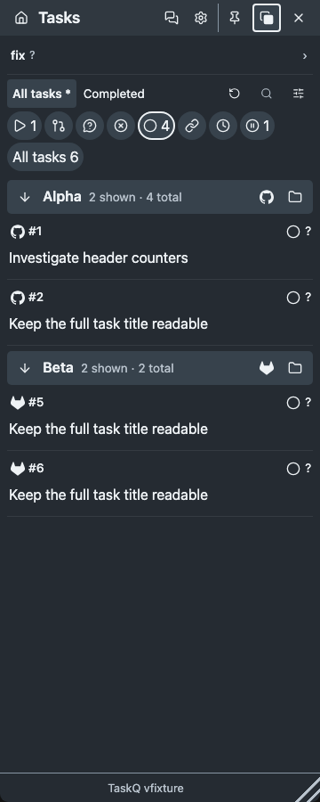
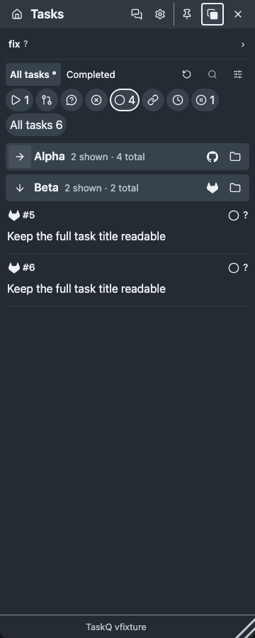
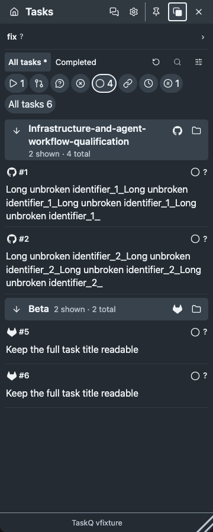

# Project group headers · #1805 · stage 1

A compact project band makes the group boundary, counts and four independent targets recognizable. The [owner answer](https://github.com/taskqorg/taskq/issues/1805#issuecomment-6489847031) approves moving Board and Folder together to the right, retaining name → overview and adding a separate collapse arrow. The [second owner answer](https://github.com/taskqorg/taskq/issues/1805#issuecomment-6490154306) selects A and moves A7 installed Mac/Windows evidence to the version PR under §7.8. The browser implementation is now included; deployment remains separate.

Canonical rule: [menu M2](../../menu.md#m2-scope-and-projects). Editable reference: [mockup](mockup.html), `?variant=a` or `?variant=b`. Open it from a checkout; it uses the existing product stylesheets and bundled icon bytes. The mockup uses invented tasks and local preview-only disclosure storage. Its board, folder and overview buttons show simulated destinations, never perform native actions.

## Usability and preservation

- Existing source, `src/task-dashboard.js::projectHeader`, renders Board → name → Folder. Its caller in `list` supplies only the project, with no counts or disclosure. The heading is secondary text, so it has weak separation from task rows.
- Put recognition first: the neutral band and bold name define a group. Keep direct Board/Folder access together. The name keeps its already approved overview action; moving it to collapse would silently remove that shortcut.
- Keep collapse separate from navigation: a labelled arrow with expanded state changes only row visibility. No nested interactive targets, queue writes or changes to filters. Back returns focus and list context.
- Counts retain both labels when equal. Collapse does not change the filter count. Unknown values retain `?` and their cause. Matching pins remain globally visible and count once; grouping does not duplicate them.
- The production slice would reach M2, the root Product decision under R13, `task-dashboard.js`/CSS, existing M8 disclosure persistence and affected dashboard/view-state checks. It reuses the current project identity, registered board/folder dispatch, task rows and native navigation store. No new configuration, service control or dependency.

## Variants

A is recommended: counts share the name line when space allows, and wrap below it for long names or large text. It uses less height for ordinary names. B always gives counts a second line, making their position predictable at the cost of taller groups. Both use the same fixture, targets, tinted band, type and icons; neither is merely a theme variant.

## Before and observed checks

Baseline: `89f007c75e2fa33c27b4cd7bbc9b48b3411ce5d9`, bundled unchanged product HTML, Ready filter, 360 × 760 CSS px, dark, 16 px. The browser reproduction observes A2/A4/A5 failures: Board and Folder split around the name, no project matched/total count and no collapse control. This is an observed production failure, not a fixed runtime.

Commands: `npm run build`; `node docs/design/evidence/1805/check.cjs --evidence --baseline`. Environment: macOS, Node v22.18.0, Chromium headless shell 156.0.8078.4, 1× scale. `tests/browser.cjs` supplies the safe worker launcher. The prototype is a development instrument, outside the CI test suite; screenshots regenerate only with `--evidence`. `--baseline` reproduces the defect against the unchanged source at this checkpoint; omit it after implementation. The full canonical gate is reserved for the rebased implementation result candidate under §7.4; no result is submitted at this stage.

| Check | Result | Scope |
|---|---|---|
| Baseline A2/A4/A5 reproduction | Fail, observed | Exact current product bundle; no fix claimed |
| Proposed geometry | Pass | Each variant: light/dark × 320/360/470 px × 14/16/18/20 px; 48 cells total; no horizontal overflow; 32 px targets |
| Proposed disclosure | Pass | Space/Enter toggle, rows hide, expanded state changes, preview reload restores collapse |
| Proposed navigation | Pass | Three separate simulated destinations; Back restores trigger focus |
| Equal counts | Pass | `2 shown · 2 total` retains both labels |
| Visual inspection | Pass | Actual-size A and B, long name, equal/unknown counts, collapsed groups; A also inspected in light; palette/assets reused |
| Owner visual acceptance | Pass | Second owner answer selects A and the §7.8 native-at-release route |
| Native Mac/Windows and screen reader | Not tested | Browser evidence does not qualify installed rendering, native effects or assistive technology |
| Rule-change gate | Pass | `python3 scripts/check.py --rules --base 89f007c75e2fa33c27b4cd7bbc9b48b3411ce5d9`: changed M2 is named by the trusted owner answer |
| Merge-result CI | Not tested | This is the design checkpoint; no result or merge is submitted |

Intentional differences from the pinned `control-panels.html` direction are confined to A2–A6: header band/name emphasis, grouped right actions, explicit shown/total counts and a separate disclosure. Task titles and metadata retain their full-width flow, existing palette, icon family and text scale. Coarse-pointer targets use the existing 44 px policy; native scaling and assistive-technology behavior remain unqualified.

## Accepted delivery and implementation

The owner selected A and the normal §7.8 self-fix route: installed Mac/Windows checks belong to the release batch in the version PR, not this task. Product and M2 record the accepted behavior before implementation. The existing native navigation document now carries a normalized `dashboard.collapsed` list keyed by canonical board identity; no new storage adapter, configuration or dependency.

The production change is confined to the dashboard header/rendering, its local presentation model and source manifests. Names, board links and registered-root dispatch retain existing targets. M8's save/readback/error handling and the task rows remain intact. Count and disclosure controls write no task, admission or host policy.

### Failure before and pass after (R12, §7.4)

`node tests/menu-project-groups.browser.cjs` against the unchanged product bundle failed at `M2: each deduplicated group needs an independent collapse control` (`0 !== 2`). The same instrument passes after the implementation. Retained protections: exact board/root targets, independent name navigation, full task titles, known/unknown counts, deduplication and pins, existing navigation IPC, keyboard focus and target sizes. No existing guard or assertion was removed or weakened. A second reproduction found that keyboard collapse left a task popover anchored to a hidden row (`1 !== 0`); the shared collapse handler now closes details belonging to that group, retaining focus on the arrow. The same browser case then passes.

- `node tests/task-views.test.cjs`: Pass; legacy navigation defaults expanded, malformed collapse input is rejected, normalized choices round-trip.
- `node tests/tray-view-state.test.cjs`: Pass; existing navigation boundaries remain protected.
- `node tests/task-dashboard.browser.cjs`: Pass; existing dashboard/view/filter/pin/navigation scenarios remain protected.
- `node tests/menu-project-groups.browser.cjs`: Pass; 48 Mac/Windows projection × theme × font × width cells, 44 px touch targets, keyboard collapse/reopen, filter disappearance/return, Back, view switches, exact destinations, matching pins, unknown counts, missing root and removed project handling. The browser accessibility tree exposes separately named controls; actual screen-reader qualification remains deferred.
- `node tests/task-workspace.test.cjs`: Pass after its documented source-manifest refresh; published-bundle/source-byte protection remains enabled.

Actual product bundle captures, invented fixtures, dark 16 px at 360 × 900 CSS px:

Visual screenlist QA inspected these three captures at actual size against A: band, name emphasis, arrow position, count wrapping and right-side adjacent shortcuts match the accepted reference. Existing chrome and task rows are preserved. Browser evidence is not installed/native acceptance; per the owner answer and §7.8 that remains in the version PR. No live service install, restart or host-policy change.

### Rebased candidate checks

Rebased onto `c761cc2ed608b26638bc295dc5f3e5a6690ffb68`. The generated screenshot-manifest conflict was resolved by regenerating the isolated capture on the combined source; no upstream source change was discarded. `docs/shots/manifest.json` pins that capture's source, binary and unchanged UI blobs. The README project view and summary icon were visually inspected; this is fixture evidence, not an installed-host check.

- `python3 scripts/check.py --base c761cc2ed608b26638bc295dc5f3e5a6690ffb68`: **FAIL**, 1.660 s, at the rule gate: `the task does not name Product (changed)`. M2 is authorized by the earlier answer. The later ask named Product, but its selected option text omitted that literal ID; the gate reads issue text and answer bodies. The accepted design is unchanged; its existing Product approval needs an explicit board record before handoff.
- The remaining checks were run separately after that early stop. All 77 `tests/*.test.cjs` scripts passed. `docs/shots/check.test.sh`, `.github/release-tag.test.sh` and `.github/release-check.test.py` passed. `docs/shots/update.sh` passed against the rebased source, with an isolated WKWebView fixture; no live install or restart.
- `cargo +stable test --locked`: **FAIL**, 91.5 s including build; unit stage: 573 passed, 19 failed, 33 ignored. One failure was R8: the new root sentence exceeded 60 KiB after the rebase (61,567 bytes). It is now a compact M2 pointer (61,425 bytes), preserving the complete linked rule. The guarding assertion was retained.
- `cargo test --locked --bin taskq core::tests`: **PASS**, 9 passed, including the R8 bound and golden-trace guard after that correction. The full Rust suite was not rerun: 17 remaining failures reach worker/operator guards or their rejected fixture receipts (`sandbox-blocked`); the recovery admission case (`recovery_service_admits_only_selected_and_keeps_pause_distinct_from_stop`) returned no child and remains **unknown**, not a pass. No permission or assertion was changed. The unit failure stopped Cargo before integration binaries ran.
- `cargo +stable run --locked -- selftest`: **PASS**, isolated temporary installation with `TASKQ_SELFTEST_OFFLINE=1`; 99 golden traces, formats and staged capture pass; board read is explicitly unknown by design.

The complete local gate is not green. Merge-result CI remains required by R12 and §7; it has not been waited for or accepted. Product/M2 approval recording is the remaining owner action; installed Mac/Windows and screen-reader qualification remain in the version PR per the accepted §7.8 route.
