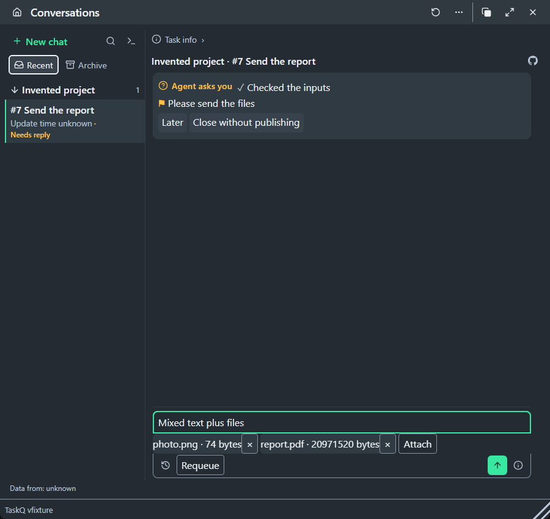
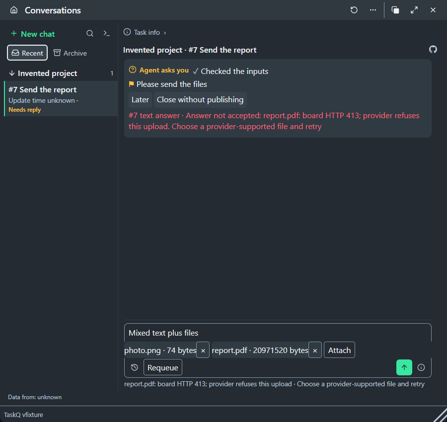

# Replies carry images and files

Task: [#1817](https://github.com/taskqorg/taskq/issues/1817). The [owner's answer](https://github.com/taskqorg/taskq/issues/1817#issuecomment-6497639463) bounds this work to TaskQ and a PilotQ-shaped fake. Live PilotQ integration is [#1857](https://github.com/taskqorg/taskq/issues/1857), held on `hermes-fra1`, depending on #1817.

## Current candidate and verification

The merge queue returned PR #1865 with `merge_conflict`. `git rebase origin/main` reproduced a conflict in `src/board/mod.rs` against `dbdcb74ec606acc95ec9c543b54d380b54e99a7a`. The resolution preserves main's refreshed `credentials.borrow().auth` and this task's file-backed HTTP response. Afterward, the rebase and `git merge-tree --write-tree origin/main HEAD` succeed. `git range-diff` shows only that credential-access adjustment to the prior HTTP patch; no test, assertion, deadline, permission or lifecycle behavior changed in this continuation.

Tested source: `9e2fb1415d4758f2baeef74f6bfce6b55fafcddf`. Only this evidence report changes afterward. Windows, warm cache; Cargo 1.99.0, Python 3.12.10, Node 24.5.0, Playwright 1.64.1. Rust fixtures use the canonical checker's temporary-installation environment; the launching worker stays bound to its attempt.

| Check | Observation |
|---|---|
| `python3 scripts/check.py --base dbdcb74ec606acc95ec9c543b54d380b54e99a7a` | **Failed**, 646 passed, 2 failed, 38 ignored; 591.328 s total, 431.58 s Rust execution. Selector/rule gate and web build pass; Rust stops later stages. |
| Full-run failures | `lifecycle::tests::stop_keeps_original_receipts_and_requires_attributable_native_exit` exceeded its unchanged 10 s fixture-preparation deadline. `runtime::app_control::tests::cancellation_is_owner_bound_bounded_and_never_replays_work` reported `owner: fixture I/O: The pipe has been ended. (os error 109)`. These are failures, not sandbox-blocked passes. |
| Isolated diagnostic runs of those exact two tests | Both pass without source changes: cancellation 4.45 s; lifecycle 1.30 s. Their full-run causes remain unconfirmed; these diagnostic passes do not turn the full gate green. |
| Attachment checks in the full run | All six pass: real 20 MiB HTTP, CLI input, PilotQ-shaped handoff, private/Unicode copies, held worker submission, and repeated text with a new file. Existing concurrent-answer and credential-refresh checks pass. |
| `cargo +stable test --locked --test integration` | Pass: 17 passed, one ignored; 18.29 s test execution. |
| Isolated offline `cargo +stable run --locked -- selftest` | Pass: 107 traces, formats and eight committed observations; board/tools unknown offline. |
| All 27 `tests/*.test.cjs` files | Pass after the rebase. |
| `node tests/reply-files.browser.cjs` | Both entry routes pass image + 20 MiB, paste/drop/pick, mixed reply, copy identities, refusal/fix and telemetry privacy. Native bridge/board remain fakes. Existing four screenshots retained. `npm ci` removed the untracked browser dependency; the documented Playwright version was restored without package/lockfile edits. |
| Artifact scripts | `sh docs/shots/check.test.sh`, `sh .github/release-tag.test.sh`, `python3 .github/release-check.test.py`: pass. An initial auxiliary wrapper timed out the shots test at 120 s; the separate diagnostic run completed in 26.922 s with unchanged assertions. |
| Rule/size/whitespace guards | Pass: amended §5 under R13; unchanged R8 guard, 61,433 bytes and 295 lines; `git diff --check origin/main` clean. |

The local full gate remains failed. Publication still needs review and green `merge_group` CI (R12/§7). Live PilotQ delivery remains unverified in #1857; no host installation or restart was performed.

## Previous concurrent-answer rebase

While the first rebased candidate was being tested, main advanced to `b4369e44ca302bbe647ea32b6fc677a1547f813c` (#1866). PR readback and `git merge-tree` reproduced new conflicts in `src/dispatch.rs` and §5. A second rebase preserves main's concurrent-answer no-op and closed-task protections together with attachment forwarding. The immutable tested source is `f08ff83779bb0765b0438b8970bf17bfefa106fd`; only this evidence report changes afterward.

The merged behavior had one attachment-specific defect: identical answer text could trigger the new text-only no-op and discard a new file. Before the fix, `cargo +stable test --locked --bin taskq reply_files::tests::new_files_keep_a_repeated_answer_distinct -- --exact` failed with `note: None`, expected `Some(true)`. After restricting that no-op to replies without files, the same check passes. The new case verifies the worker-readable image and that a retry with the accepted operation ID writes nothing. Main's existing text-only duplicate, race and closed-task assertions remain unchanged and pass.

| Check on the current source | Observation |
|---|---|
| `python3 scripts/check.py --base b4369e44ca302bbe647ea32b6fc677a1547f813c` | **Failed**, 627 passed, 18 failed, 38 ignored; 142.546 s. Selector/rule gate and web build pass; Rust stops subsequent stages. |
| Remaining failures | The same 18 worker-restricted host/lifecycle/resource/tray/security fixtures described below: sandbox-blocked (§7.4), never PASS. No permission or worker-authority guard was bypassed. |
| Attachment and concurrent-answer checks | All six attachment checks pass, including the real 20 MiB HTTP transfer and the new same-text/new-file case; main's concurrent-answer checks pass. |
| R8 guard in the full run | Pass, unchanged guard: contract is 61,438 bytes and 295 lines. |
| `cargo +stable test --locked --test integration` | Pass: 17 passed, one ignored; 17.69 s test execution. |
| Isolated offline `cargo +stable run --locked -- selftest` | Pass: 107 traces, formats and nine committed observations; board/tools unknown offline. |
| Node and browser | Fresh run: all 27 `tests/*.test.cjs` files pass, as does `node tests/reply-files.browser.cjs` on both routes. Native bridge/board are fakes. The existing four screenshots are retained. |
| Artifact scripts and whitespace | Earlier artifact-script passes below remain valid: those scripts and inputs are unchanged. Fresh `git diff --check b4369e44ca302bbe647ea32b6fc677a1547f813c` passes. |

Amended rule: §5 under R13. Local merge-tree check against `b4369e44` is clean; this is not merge-result CI. Publication still requires review and green `merge_group` CI (R12/§7). Live PilotQ delivery remains unverified in #1857; no host was installed or restarted.

## First rebase verification

The reviewer returned [PR #1865](https://github.com/taskqorg/taskq/pull/1865) for a `src/runtime.rs` conflict with `c7008b76df6d60a4dad985608913aafc6838a668`. Rebase reproduced that conflict. The resolution keeps main's `session_id` helper and adds `files: String::new()` to its `Launch`; `git range-diff` shows no other change to the attachment patch. No assertion, runtime permission or lifecycle rule changed.

Tested source: `8b7d2b0d3b069be05a77599e367958ca9e931ae8`, based on `c7008b76df6d60a4dad985608913aafc6838a668`. Only this report changes afterward. Windows, warm build cache; Node 24.5.0, Python 3.12.10, Cargo 1.99.0.

The first post-rebase canonical run at `ca475865bf0df4615a3286a4428d851a4ace51be` failed: 625 passed, 19 failed, 38 ignored, 224.328 s. Besides the 18 worker-restricted fixtures below, the real HTTP attachment fixture reported `curl: (56) Recv failure: Connection was reset`; the unchanged fixture then passed in isolation, so the precise cause remains unconfirmed. The fixture now shuts down its response side and observes the client's EOF before dropping its socket handles. The original 20 MiB POST, response and binary-download equality assertions remain; unexpected trailing request bytes also fail. Production HTTP behavior and its deadlines are unchanged.

| Check | Current observation |
|---|---|
| `python3 scripts/check.py --base c7008b76df6d60a4dad985608913aafc6838a668` | **Failed**, 626 passed, 18 failed, 38 ignored; 106.781 s. Selector/rule gate and web build pass; Rust stops subsequent stages. |
| Remaining 18 failures | Sandbox-blocked under worker authority (§7.4): host install/capacity, lifecycle, resources, tray capacity and Windows security restore fixtures. Existing guards remain; no authority environment was removed. This is not a green full gate. |
| `cargo +stable test --locked --bin taskq board::tests::reply_files_cross_real_http_without_process_buffer_caps -- --exact --nocapture` | After fixture change: pass, 0.53 s test execution; also passes in the fresh full run. This does not establish the exact cause of the earlier reset. |
| All five attachment checks in the full run | Pass: real 20 MiB HTTP, CLI input, PilotQ-shaped fake, private/Unicode storage and worker submission held until files are readable. `session_links_follow_the_adapter` also passes. |
| R8 guard in the full run | Pass, unchanged guard; contract remains 61,439 bytes and 295 lines. |
| `cargo +stable test --locked --test integration` | Pass, 17 passed, one ignored; 17.58 s test execution. |
| Isolated offline `cargo +stable run --locked -- selftest` | Pass: 107 golden traces, formats and nine committed capture observations; board/tools unknown offline. Direct `target/debug/taskq.exe selftest` could not load a DLL (exit `0xC0000135`); Cargo supplies build paths. This is not installed-loader qualification. |
| `Get-ChildItem tests/*.test.cjs` with `node` per file | All 27 files pass after the rebase; no JS, fixtures or build source changed afterward. |
| `node tests/reply-files.browser.cjs` | Both Conversations and tray entry routes pass after the rebase, including the image, 20 MiB file, mixed reply, paste/drop/pick, refusal/fix and telemetry checks. Native bridge and board remain explicit fakes. No screenshots recaptured; the four-screen set below is retained. |
| Artifact scripts | `sh docs/shots/check.test.sh`, `sh .github/release-tag.test.sh`, `python3 .github/release-check.test.py`: pass. |

Amended rule: §5 under R13, as requested by A1. Merge-result CI remains required by R12/§7; live PilotQ receipt stays unverified in #1857. No host installation or restart was performed.

## Prior attempt: candidate and scope

Canonical gate source: `02c2b261aeaef4c8c8e4f5c2572d248b17d7f16f`, rebased once on `20c8a6d37680098080717679d3ffe138d70055a0`. The final candidate changes only `taskq.md` and this evidence directory after that gate. Rust, JS, tests, dependencies and build scripts remain identical to that source. The contract follow-up shortens §5 without changing its decisions and passes the unchanged R8 guard.

R13/§5: task replies accept text, images and arbitrary regular files without TaskQ size/count caps. Owned private copies retain names and extensions; the CLI accepts repeated `--file` or `--files-from` JSON path lists. Existing board adapters upload and read back every file before the command comment. Accepted board manifests reconstruct verified worker files before native submission. Source files, operator grants and owner-session C3 limits remain protected.

The rebase preserves #1838: files accompany a changed/late answer's durable note, retaining its original question revision. Model acceptance determines which comments may supply files. The current question, retry identity and unknown-delivery fence remain intact.

## Prior attempt: before and after

Before implementation, `node tests/reply-files.test.cjs` failed with `file-only image + 20 MiB document must reach the operation`: the actual operation was `undefined`. After implementation the same test passes, including mixed files, file-only input, pending/refused copies, unknown retry, changed questions and more than four files.

The first real HTTP fixture failed with Windows socket error 10035: an accepted socket inherited nonblocking mode. Setting that fixture socket to blocking retains every request/body assertion; the 20 MiB POST, response and download now pass. No production socket policy changed.

The first canonical run found the contract at 61,866 bytes, over R8's unchanged 61,440-byte ceiling. After condensing §5, the contract is 61,439 bytes and 295 lines; `core::tests::every_table_row_has_a_golden_trace` passes. No trace, limit or assertion was removed.

## Prior attempt: verification

Windows; Node 24.5.0, Python 3.12.10, Playwright 1.64.1. Existing Git Bash tools were added only to the test process's PATH. No host policy, installation, service or live Telegram client was changed.

| Check | Observation |
|---|---|
| `python3 scripts/check.py --base 20c8a6d37680098080717679d3ffe138d70055a0` | Full selection; 615 passed, 19 failed, 38 ignored; 279.266 s. Failed, never reported green. |
| Attachment checks in that full run | All five pass: downloaded media/worker copies, private storage/refusal, real HTTP, CLI input and held worker submission. Includes a valid PNG, a 20 MiB file, Unicode names, preserved binary bytes, corruption and same-operation retry. |
| Remaining full-run failures | Eighteen host-policy/install/lifecycle/resource/security fixtures under worker authority: sandbox-blocked (§7.4). Observed refusals include `a worker cannot change host policy`, `a worker cannot install the host service`, `a worker cannot restart the host service or request Stop`, and `Windows security restore requires an unrestricted operator`. No permission guard was bypassed. |
| R8 follow-up | The unchanged golden-table/size check passes after the contract-only correction; full Rust was not rerun for this prose-only correction. |
| `node tests/*.test.cjs` via a PowerShell file loop | All 27 files pass. Source/asset provenance and existing answer/steer controls remain checked. |
| `node tests/reply-files.browser.cjs` | Both Conversations and the tray-to-Conversations route pass paste/drop/pick, mixed text/files, image + 20 MiB, copy identities, exact refusal/fix and refusal telemetry without reply content or file names. Native storage/board receipt is an explicit fake. |
| Existing `tests/tray-answer.browser.cjs` | Passed all four light/dark and 16/20 px journeys during development. The combined post-rebase Node fixtures also pass #1838's changed-question semantics. |
| Isolated offline `cargo +stable run --locked -- selftest` | 107 golden traces and formats pass; nine capture observations commit in the temporary store. Board is unknown/offline, as expected. |
| `cargo +stable test --locked --test integration` | 17 passed, one ignored. |

The canonical run stopped at Rust failures. Node, offline selftest and integration were therefore run separately; their passes do not convert that run to green. Merge-result CI and target-platform acceptance remain separate under R12/§7.

## Four-screen review set

Chromium captures of the published HTML bundle, dark theme, 900 × 850, with invented project/task/file data. The tray's actual Open question action is checked before loading its shared composer with a substituted native bridge. These are browser observations, not installed native-window or live bot acceptance. Both entry routes reach the same composer, so their before views are identical.

| Entry | Before Send | Refused Send, files kept |
|---|---|---|
| Conversations | [Before](workspace-before.png) | [Refusal](workspace-refusal.png) |
| Tray | [Before](tray-before.png) | [Refusal](tray-refusal.png) |

Not deployed. Live PilotQ receipt is unverified here and belongs to #1857. Public GitHub publication still requires green `merge_group` CI; this worker does not wait for CI (§7).
