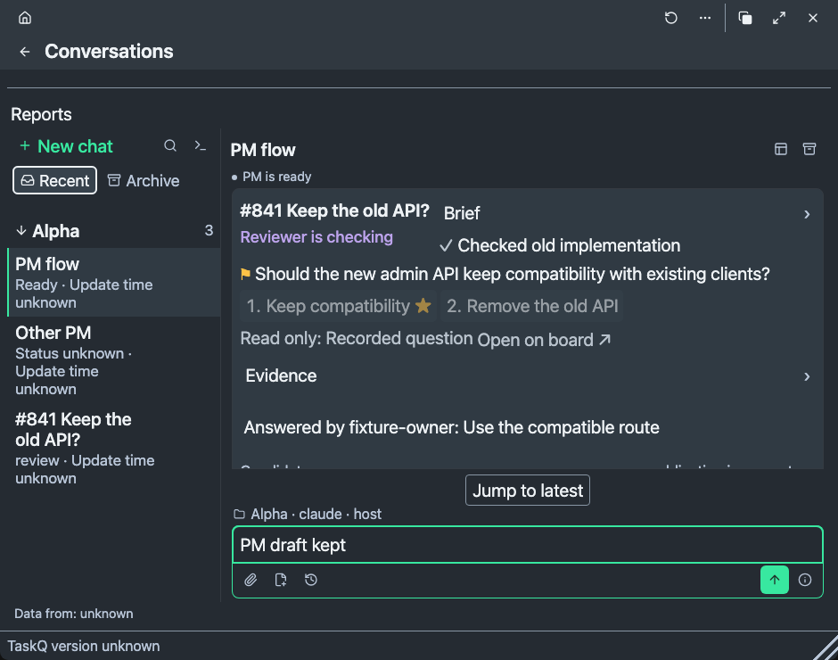
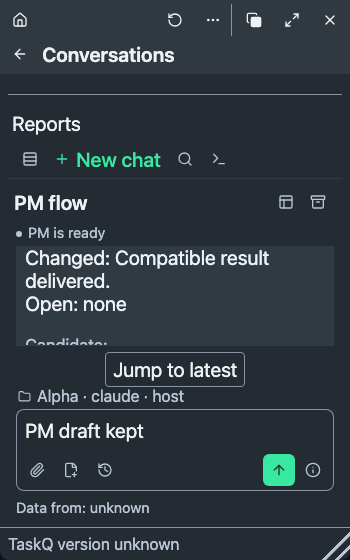

# Conversations: PM to result (#1929)

This candidate connects an originating owner chat to its held brief, assignment, worker question, answer, reviewer and result. R1/R13: the owner's selected board-held reference is on #1929; `add --conversation ID --op-id ID` records it on the first accepted `hold`. A create claim binds that reference. No task state, transcript or execution moves to a new database, scheduler, gateway or writer.

## Before and after

- `node tests/conversations-flow.browser.cjs` first failed with `A5: a working worker accepts input before any question`, `0 !== 1`. The same check now exercises worker input, retained draft, same-operation unknown reconciliation and the complete originating-chat chain with invented receipts. Native consumption remains separate.
- The old owner scroll handler resumed follow when scrolling to the bottom. The flow check now uses wheel-up and then scrolls down: Latest remains explicit. Source replacement clears the old generation and waits for Latest. #1742 remains the bounded reader; worker history uses its window/anchor/edge helpers too.
- The board-answer reflow reproduction failed on the previous native-only anchor helper. The shared helper now also anchors stable board task/revision records; the same check passes across width reflow and switching away/back, without a second reader or cache.
- Transcript children could flex-shrink under a long draft. They now keep natural height. The shared composer measures a hidden copy, never collapses the live field, and keeps primary tools at the reader's edge for long drafts. The exported PM composer reuses this measurement; API signatures stay compatible.
- Visual review found a short composer treated as long at narrow width, hiding Send while reading the result. Only an editor taller than its reader now uses long-draft placement; Send remains reachable. Two fixture captures accompany this report; neither is native evidence.
- Before, Completed rows omitted answered questions and their evidence. The Rust chain now reads the original question, Done and evidence after closure. Historical questions reuse the read-only shared card; they keep choices, gains/costs, media and evidence rather than only the problem text.
- Unknown owner reply delivery previously had no immutable readback operation. Its existing draft now keeps an optional reply intent; the existing native turn records its operation ID. Check delivery reads that ID/input without dispatching. New independent edits and files remain. A matching acknowledgement clears intent. Holder probes use the existing bounded action-queue implementation off the window event loop.

## Source and fixture checks

Development commands: `cargo test --locked --bin taskq conversation_1929`, `node tests/tray-answer.test.cjs` and the affected browser instruments below. On `b087aac4`, `python3 scripts/check.py` passed rule/contract guards and 728 Rust unit checks, then stopped with 20 integration passes and `sandbox-exec: sandbox_apply: Operation not permitted` in the protected-export case. This is sandbox-blocked, never PASS. Its assertion remains unchanged. The final A6 wording run reproduced that sandbox restriction (728 unit and 20 integration passes). The remaining gate commands ran separately: all 29 Node component files, shot/release fixtures and nine affected browser instruments passed in 138.877 s; offline selftest passed in a private temporary installation. The final candidate SHA is on the task/PR; publication still requires green merge-result CI (§7/R12).

| Acceptance | Evidence boundary | Remaining qualification |
|---|---|---|
| A1 / UX30-11 | Rust create/hold/replay/hash and closed Q&A chain; `conversations-flow.browser.cjs` held → one Start → worker → question → answer → reviewer → board result in the PM chat | Real disposable native/board exchange after release |
| A2 / UX30-12 | `conversations.browser.cjs`, `conversations-selection.browser.cjs`, `dialogue.browser.cjs`, `conversations-declutter.browser.cjs`; visible first-Send/project purpose; continuing PM remains direct | Native ownership, window gestures and screen readers |
| A3 / UX30-13 | Flow and PM-composer browser checks: natural growth, no grip/inner field scroll, unshrunk transcript and reachable Send; stable/declutter geometry checks | WKWebView/WebView2 physics, all real scales |
| A4 / UX30-14 | `conversations-render.browser.cjs` (#1742), `conversations-stable.browser.cjs` (#1741), generation Rust check, worker-panel browser check | Native find/Select All/scrollbar/IME and provider generation behavior |
| A5 / UX30-16 | Flow and shared-answer checks; current running worker before any question; revision-bound existing steer, source question choices, files and fluent races retained | Real worker delivery/consumption and replacement races |
| A6 / UX30-15 | Rust immutable-turn/restart readback, flow and stable adverse fixtures; delivery, activity and outcome have separate labels; ended/reviewer/unknown input keeps drafts/files | Real outage/restart/one-writer qualification |
| A7 | Existing #1918 history and grouped steps reused, original closed Q&A/evidence retained; no parallel event store | Real provider group/page seams |
| A8 | Existing source/component/browser journeys re-run; finite adverse/performance coverage below | Full native acceptance remains Not tested; no native pass is claimed |

The eight daily journeys retain their existing destinations: (1) exact question/answer via flow, reply-files and workspace-communication; (2) PM send/continue via Conversations/dialogue; (3) old decisions via #1742; (4) Later versus archive/Undo/delete via existing controls and selection/stable checks; (5) slow/refused/unknown via immutable readback and adverse fixtures; (6) discovery/saved views/Completed remain the existing menu and View components; (7) native links, history, files, Watch, rename and detach/return remain their existing routes; (8) Settings/service reviews remain the existing operation workspace. The canonical UI30 preservation ledger remains [ui-polish-capabilities.md](../../ui-polish-capabilities.md). Menu/Settings journeys are preserved source boundaries, not a claim that native service effects ran.

Q-A1 belongs to the retained #1928 menu reader. Q-A2–Q-A5/Q-A7/Q-A8/Q-A11 have source/browser coverage here. Q-A6 has measured headless observations, not an adopted performance budget. Q-A9/Q-A10 have partial browser coverage; real accessibility/scales remain Not tested. Q-A12, two real disposable native PM turns and restart/one-writer proof, remains in the release qualification tasks #1932/#1933 under §7.8.

The initial #1742 requalification traversed 10,000 variable-height records for both normalized providers, reached the start and returned to Latest, preserved anchors within 2 CSS px, and exercised ignored-only pages, stale/out-of-order responses and selected text. On macOS arm64, warm local build, Chromium headless: mounted maximum 662/643; page-receive/render p95 42/31 ms, maximum 146/37 ms; wheel-frame p95 67/67 ms. After the board-record anchor fix, the final warm run mounted at most 662/643 items, with receive/render p95 21/24 ms (maximum 26/26 ms), no observed long tasks, and wheel-frame p95 67/67 ms. These observations do not establish native smoothness or cold I/O. Rust's retained transcript checks cover 10/100 MiB, long/oversized records and partial/UTF-8 boundaries; the new check adds generation preservation/replacement. Native provider duplicate/sidechain/compaction semantics remain unqualified.

## Guard changes and limits

The first canonical gate stopped before tests because the accepted ask named R1/R13, while the origin reference was placed in Product and §5. The reference now lives under its approved R1 owner; Product/§5 and the rule gate remain unchanged. The next run passed the rule gate, then failed the unchanged 60 KiB contract guard (61,598 bytes; 727 Rust checks passed). Moving its detailed command wording to the linked specification leaves the R1 pointer within that cap; the guard is unchanged.

A3 intentionally replaces guards requiring the whole long editor or whole question to fit simultaneously: protection now checks natural content, one traversable reader and reachable Send. A5 retains #1817 files, replacing the retired text-only Attach assertion. A6 labels the immutable service queue receipt as “Message saved”; PM activity/consumption remains separate. Its browser guard still requires the accepted receipt and draft clearing. A6 replaces an absent reviewer control with an explicit read-only explanation while retaining no-send protection. Shared-answer guards retain winner attribution, no duplicate note/send, original source ordering and read-only history. The small-window badge assertion now names its actual #41 fixture, not unrelated #841 data.

Native generations use file identity and the first record prefix. Arbitrary later in-place rewriting with that identity/prefix retained is not detected; qualify provider behavior before claiming it. Reply recovery adds optional fields in existing owner-request metadata; older readers refuse uncertain new records and retain bytes, rather than replaying them. Acknowledged drafts omit the field. Owner attachment limits remain separate from uncapped task replies. No installation, restart, grant change or real owner-task answer was performed.

Invented board/native fixture, dark 940×740 CSS px, 20 px text. The original question, checked work, evidence, answer, reviewer state and independent PM draft share the reader.

Invented fixture at 350×560 CSS px. The result and publication status remain board facts; the independent PM draft and Send stay reachable.
