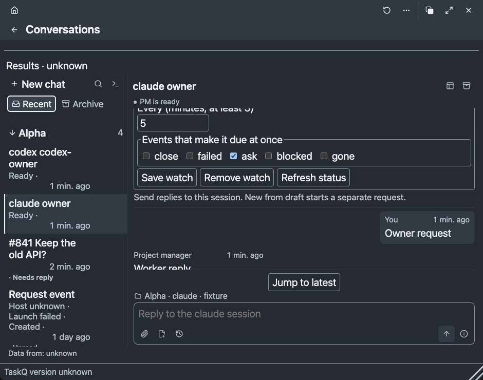
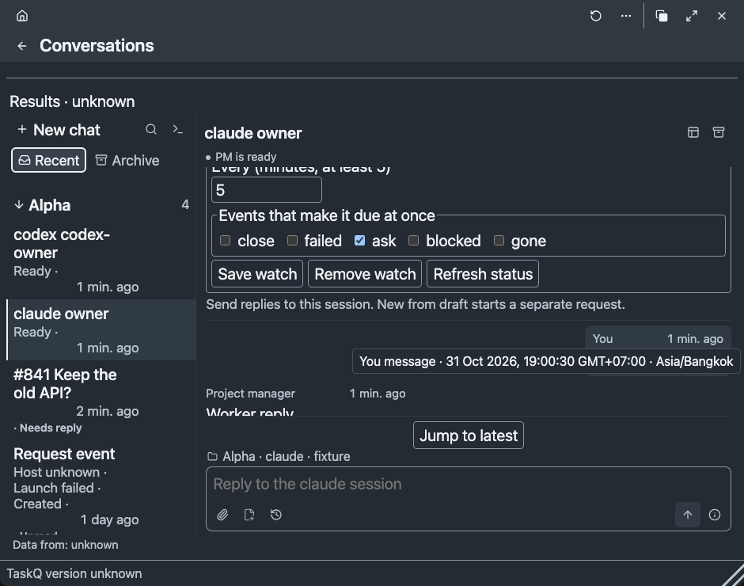

# Conversations time evidence — #1930

One production renderer supplies relative labels and exact local time to Conversations (UX30-17–19, D-A19). The root contract already adopts these UI30 targets (R13); no R-number changes. R12 separates this source/browser proof from native acceptance. No installation, service, permission or live conversation was changed.

## Failure before / pass after

- Baseline `efce57d9295abd72184778d2ab32ab4e46a683f0`: the new production-bundle time check fails `native messages must expose relative timestamps`. Its baseline instrument substitutes the original Conversations/workspace modules into the bundle; fixture clocks are invented.
- The extended `snapshot::tests::sidebar_activity_projects_trusted_comment_time_not_observation` fails `a missing newest event cannot borrow an older comment time` before the projection fix. Afterward it passes: the newest trusted unedited comment is selected by native identity, missing time stays null and issue creation is never substituted. Trusted/unedited filtering remains protected.
- Expanded Status initially overflows at 350 px / 20 px. Stacking its definition list at narrow widths fixes that cell without reducing type or adding a scrollbar.
- Existing dialogue/tool checks now select message/tool content separately from its new time label. They retain file order, tool grouping/counts, single-line summaries, owner attribution, unknown-read recovery, reply preservation and watch controls.

## Acceptance and checks

| Acceptance | Observation | Verdict |
|---|---|---|
| A1 | Shared renderer on owner/worker messages, single/grouped/expanded tools, native briefs, linked briefs/results, current/historical questions and answers, events, sidebar and request/turn/watch facts | Pass, source/browser |
| A2 | Just now; minutes/hours/days; truthful future; exact seconds, UTC offset and IANA zone; visible keyboard tooltip and accessible event attribution; timezone formatter refresh | Pass, component/browser; native screen reader Not tested |
| A3 | Native `updated` passed unchanged; byte `at`/`i` remain ordering/cursors; explicit board-second conversion; request creation, turn submission and watch dispatch/schedule are separately attributed | Pass, adapter/component |
| A4 | Invalid, zone-less, missing and unavailable source values stay Time unknown with a reason. Missing newest tool/record never borrows an older time; failed status clears cached activity | Pass |
| A5 | A minute tick preserves every time/record/sidebar node, source value, order, active focus and reading offset within 2 px; labels alone change | Pass, both engines |
| A6 | Owner/remote-worker/grouped tools/native brief/current and historical question/event/list/archive; future/invalid/missing; exact focus; minute boundary; 350/620/940 px × 14/20 px × dark/light | Pass, 12 cells per engine, 24 total; native platform qualification separate |
| A7 | Actual local Claude/Codex metadata and public board comment dates inspected; source-shaped sanitized fixtures through native readers; source gaps; encrypted remote adapter round-trip | Pass at source/adapter boundary; live two-host/native acceptance Not tested |

Commands:

- `node tests/relative-time.test.cjs`: Pass; strict dates, explicit units, minute/hour/day/future boundaries, source values and timezone changes.
- `node tests/conversation-times.browser.cjs`: Pass on Playwright Chromium headless shell and WebKit, 24 geometry/theme/type cells plus behavior checks. Browser clocks/receipts are explicitly invented.
- `cargo test --locked --bin taskq sidebar_activity_projects_trusted_comment_time_not_observation`: Fail before, Pass after.
- `cargo test --locked --bin taskq conversation_1930_observed_native_times_survive_pages_and_gaps`: Pass.
- `cargo test --locked --bin taskq a_read_crosses_the_fake_relay_sealed_and_fenced`: Pass; remote timestamp bytes retained across the existing encrypted request/reply path, attempt/cursor fence and no retained history.
- `node tests/dialogue.browser.cjs`, `node tests/conversations-flow.browser.cjs`, `node tests/worker-panel.browser.cjs`, `node tests/conversations-sidebar.browser.cjs`, `node tests/worker-steps.test.cjs`: Pass.
- Canonical gate after the single rebase: pending below.

The browser instrument uses the production `build/web/workspace.html`, Playwright 1.64.1, Chromium 156.0.8078.4 and WebKit 27.2 on macOS arm64. Temporary browser installation stays outside product state. This is neither an installed TaskQ WebKit view nor Windows WebView2 evidence.

## Source provenance and gaps

[Sanitized fixtures](../../../../tests/fixtures/conversation-time-provenance.json) keep observed timestamp strings and record shapes; message text, tool arguments and names are invented replacements. Read-only samples include actual Claude user/assistant/tool records at `2026-10-30T18:52:26.570Z` onward and Codex response-item user/assistant/tool records at `2026-10-30T22:21:48.396Z` onward. Both native readers preserve exact timestamp bytes in forward/backward pages and refuse an earlier-time fallback when the newest record has no time.

GitHub metadata was read with `gh api repos/taskqorg/taskq/issues/1930/comments` after the connected comments tool omitted dates. Public [hold](https://github.com/taskqorg/taskq/issues/1930#issuecomment-6523625372) and [spawn](https://github.com/taskqorg/taskq/issues/1930#issuecomment-6534732938) dates become explicit board seconds in the fixture. IDs are never interpreted as dates.

The current history adapter omits per-question/answer/brief/result times; those locations explicitly expose this adapter gap rather than infer from a later task state or request time. Request event records expose request creation only, not the time of their launch/failure transition. Remote transport is covered with a substituted relay; no live remote machine or additional conversation was contacted. Native VoiceOver/NVDA, WebView2, installed OS interactions, system timezone changes in a running native view and integrated macOS/Windows acceptance remain Not tested under R12 / §7.8 (#1932/#1933).

## Visual review

Inspected actual-size Chromium and WebKit renders, including tool summary, source gaps, owner/worker alignment, sidebar creation attribution and focused exact-time tooltip. Both retained existing icons, palette, type and reader/composer layout. The matrix keeps variant coverage in the script rather than committing every screenshot.

Representative Chromium fixture screens (invented content/clock):

