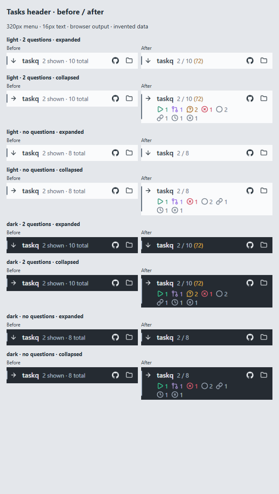

# Tasks board header

M2 now uses compact shown/total counts, a nonzero question count and collapsed status counts, as approved in [#1952](https://github.com/taskqorg/taskq/issues/1952#issuecomment-6527517317). R13: specification amended before implementation. R12: browser evidence does not qualify native rendering or owner visual acceptance.

The comparison captures the actual before/after bundled Tasks header with identical invented board inputs: expanded/collapsed, two/no questions, light/dark. The view filters to Ready; questions and status totals still cover all loaded open board tasks. No live board requests or task changes occur. `capture.json` records source revisions, bundle hashes, environment and the eight cases. The implementation revision precedes this evidence-only commit.

Route: menu Home → Tasks → project group header. The left column is the current header at `82fb5dc76b4a7db4dec83dea92d7b00bcb2e5ac9`; the right column is the changed implementation. Windows Chromium headless shell, Segoe UI 16px, 320×760 CSS-pixel menu, scale 1. Capture with `node docs/design/evidence/1952/capture.cjs <baseline tray.html> <baseline SHA>` after building both revisions with `npm run build`.

## Verification

- Before: `node tests/menu-project-groups.browser.cjs` failed the new compact-count assertion: actual `2 shown · 4 total`, expected `2 / 4`.
- After: the same browser check passed. It covers filtered/pinned questions, duplicate registrations, all eight nonzero status counts and accessible names, hidden zero counts, unknown data, no added board reads and retained collapse/navigation controls.
- Geometry and computed status colors pass for macOS/Windows projections, light/dark, 14/16/18/20px and 320/360/470px: 48 cells, each expanded and collapsed. Existing 44px touch targets remain protected.
- The existing disclosure check now targets the inline task details shipped by #1955; collapsing still removes the hidden task's details. Count assertions change only for the approved M2 format; count meaning, unknown handling, pin deduplication and independent action checks remain.
- Initial color checks exposed that the browser fixture lacked the native palette input. The fixture now supplies palette A from `src/icon.rs`, and each header status color is compared with the corresponding panel counter.

The canonical candidate gate is recorded in the PR and task result (§ 7.4). Installed WebView2/WKWebView rendering, assistive technology and owner visual acceptance are not tested by this browser instrument. No deployment was performed; merge-result CI remains the publication gate (§ 7, R12).
