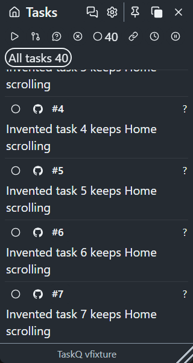
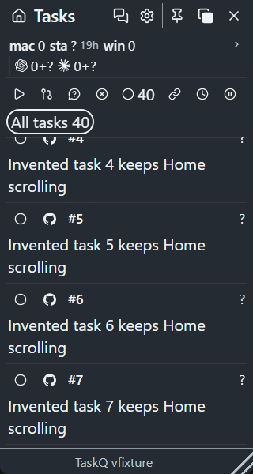

# Home host strip and retirement

R13: the approved changes align Product, section 4, M1.2, M3 and M3.1. Retirement means closing a host's heartbeat issue on every board. Open stale heartbeats remain unknown; closing an issue never proves that its execution ended (R11/R12).

## Before and after

The two-screen review set uses invented observations: Windows layout, Chromium headless, 320 × 600 CSS pixels, 20 px text, dark theme, background opacity 100%, Home scrolled 430 px. The same fixture has 40 tasks, two fresh hosts and one open stale host.

| Before | After |
| --- | --- |
|  |  |

Before source: `ed179014e7b7fd4ad1f08c822142924dc8ea9382`. Implementation source: `4bce1c9f2ead15b48010f5feca384d09ad53d134`.

- `node tests/tray-home-header.browser.cjs`: before, FAIL `A3: Home host strip stays at the top after scrolling`; after, PASS. It checks host/filter placement and hit testing at multiple scroll positions, expanded details and the last task, narrow/wide menus, 14/20 px text, both themes and background opacity 0/100. Refreshing without a heartbeat removes both remote and local named chips.
- `node tests/tray-running.test.cjs`: the added retirement case failed before the strip-membership fix (`?`, expected no named chip), then passed. Existing idle, stale, partial, conflicting and duplicate execution counts, runtime totals and resource details remain protected. No heartbeat produces generic `Hosts ?`, not a retired local host's name.
- `node tests/tray-background.browser.cjs`: PASS. Both pinned rows must remain opaque; independently fading either row makes the instrument fail. Other fills and foreground opacity retain their protections.
- `node tests/ui-polish.browser.cjs`: PASS, 416 geometry cases. Filters now pin below the host strip; counts, accessible names, wheel scrolling, keyboard destinations and clearing Home scroll padding in Settings remain protected.

The new `tray::tests::retired_host_leaves_status_and_strip` follows heartbeat closure through the existing board collector, status text/JSON and tray liveness input. It retains an open stale host and requires separate closure on each board. The board adapters already list only open issues; no live heartbeat issue was changed by this task.

Set `HOME_HEADER_EVIDENCE` to a scratch directory when running the Home browser instrument to reproduce the after capture. Node 24.5.0, Playwright 1.64.1, Rust/Cargo 1.99.0; Windows source checkout. These are browser/source checks, not installed WebView2 or WKWebView qualification or owner visual acceptance (R12). Merge-result `merge_group` CI remains the publication gate under section 7.
