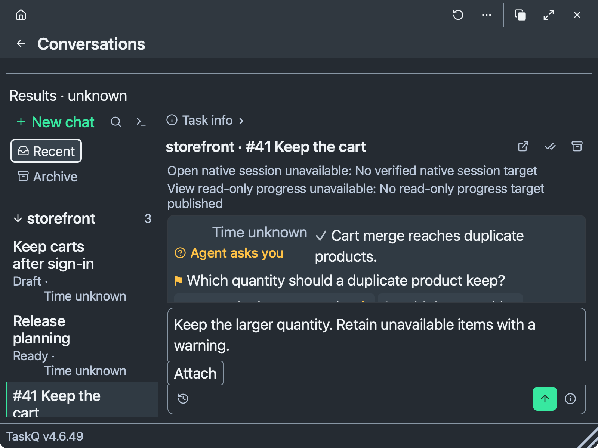

# Conversations composer verification · #1991

Send is already visible in the reported failing #1932 fixture. No layout correction is justified by this reproduction. The only application change restores the received recovery instruction after a rejected worker message in the shared composer. No transport, permissions, file limits, answer rules or layout changed. No contract decision changed (R13).

## Native baseline and candidate

Baseline source: `e0bab07ef121d367d1ee7444861bc3d4373918b5`. Its composer, reader and question fixture sources are unchanged from #1932's `554552daf48d5b413918d54a8a6d0f88efba4020`.

The signed Cargo run of `tray --snapshot "$fixture/before" --route conversations` exited 0 and produced ten images at 800×600 logical points, 2×. Its dark question 20 px image is byte-identical to [#1932's reported failing frame](https://github.com/taskqorg/taskq/raw/cfd4fbcb3af0f3c95c07e61d69346f3a33a1964f/docs/design/evidence/1932/screens/04-answer-send-missing-20.png): SHA-256 `ce04b1a688b846b09f2c74c9796531b5f3926248cca7719433bdefae7825390a`. Both visibly contain the green Send arrow, Attach, History and help. The missing-Send diagnosis in that report is contradicted by its own image.



[Native measurements](native.json) record three six-cell runs: baseline, unchanged recheck and candidate after the recovery-text correction. Each checks dark/light at 18/20 px in 800×600 points, plus dark/light at 20 px in 350×600 points. [The runnable probe](capture.swift) loads the production bundle and the unmodified #1932 fixture into a nonpersistent native WKWebView, with no native IPC bridge. It asserts full button bounds, center hit-tests, exact text size, no textarea overflow, no manual resize and no answer/session/file effects. All 18 cells passed. PNG hashes preserve the per-cell capture identity; matrix variants remain disposable rather than adding theme/size duplicates to the review set.

| Native cell | Baseline / recheck / candidate | Send bounds, logical points | Textarea client / scroll height |
|---|---|---|---|
| 800×600, dark/light, 18 px | Pass / Pass / Pass | x713, y518, 32×32 | 39 / 39 |
| 800×600, dark/light, 20 px | Pass / Pass / Pass | x713, y518, 32×32 | 70 / 70 |
| 350×600, dark/light, 20 px | Pass / Pass / Pass | x263, y518, 32×32 | 70 / 70 |

Natural-size visual inspection covered the original 20 px frame and all six candidate matrix cells. Send, Attach and help remain visible. The question/options retain the shared reader; the sticky composer may cover its lower content until the reader is scrolled. That is not a missing Send control or an additional textarea scroll.

The probe's first development version timed out because off-screen WKWebView suspends `requestAnimationFrame`. The retained instrument waits for the existing fixture using timers, with a 50-second process deadline. An intermediate palette-free probe established geometry only; accepted images use the palette values from `src/icon.rs`. Neither development run is counted as a product failure or acceptance pass.

## Preservation and the small correction

`node tests/conversations-flow.browser.cjs` passed on the production bundle: working-worker input, immutable unknown-delivery recovery, explicit follow, unshrunk history, long-draft Send and independent PM/task drafts. `node tests/conversations.browser.cjs` passed: independent drafts/caret/files, archive/restore, history fill-only, IME, immutable IDs, delivery failure, close/reload and narrow layout. These use invented receipts, not live sessions or board answers.

The existing `tests/tray-answer.browser.cjs` initially timed out at line 168: its old `doing` fixture lacked a running worker execution, so the current composer correctly disabled input. The fixture now supplies worker role, attempt and a matching running execution, and addresses the existing Send control. No guarding assertion was removed or weakened.

That exposed a real adjacent preservation defect: line 173 expected `Worker is no longer running` followed by `Refresh the task`, but the UI showed only `not accepted: Worker is no longer running`. After the correction, `node tests/tray-answer.browser.cjs` passed all four light/dark × 16/20 px cells. The shared steer composer now appends the receipt's existing `next` field, as other answer receipts already do. Its existing assertion retains refusal/recovery protection; long literal text, action identity and immutable retry checks remain.

## Reproduction

Run from this checkout on macOS with the documented Node/Playwright setup:

```sh
node scripts/build-web.cjs
fixture=$(mktemp -d)
sh docs/design/tray-fixture.sh "$fixture"
TASKQ_INSTALL="$fixture/install" TASKQ_INCIDENT_REPORTS=off cargo run --locked -- tray --snapshot "$fixture/tray" --route conversations
swift docs/design/evidence/1991/capture.swift "$PWD" "$fixture/native"
node tests/conversations-flow.browser.cjs
node tests/conversations.browser.cjs
node tests/tray-answer.browser.cjs
```

The tray fixture has no board token or service. The Swift probe has only a local IPC sink. No owner session, real board answer, native launch, install, permission, service configuration or global UI setting was changed (A4, R9). No TCC denial or prompt was observed.

## Acceptance and limits

| Item | Observation |
|---|---|
| A1 | Pass: native 800×600, 20 px, both themes; Send/file/help tools visible and hit-testable; text retains 20 px without inner input scrolling. |
| A2 | Pass at the exercised source/component boundaries; existing question/options, one reader, automatic growth and separate draft/file rules remain. Browser checks do not qualify real provider delivery. |
| A3 | Native baseline/recheck/candidate evidence recorded at 18/20 px in both themes and at narrow width. The reported missing-Send failure is not reproduced; no failing-before/fixed-after layout claim is made. |
| A4 | Pass for these disposable checks: no live owner or board action. |

R12: these are native renderer snapshots and scripted DOM hit-tests, not a physical mouse, VoiceOver, provider or installed-release qualification. The result does not claim a missing-Send fix. R5 and §7 require the task result to retain that limitation. No task was closed, reopened or manually relabelled.
