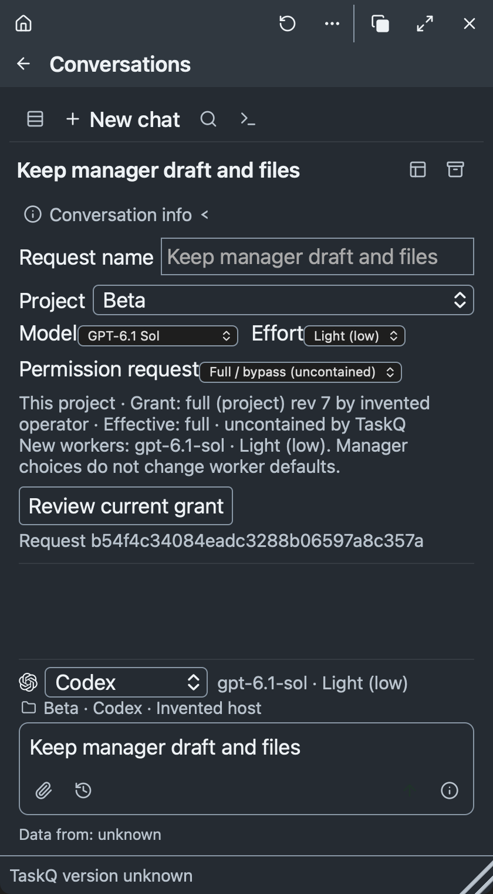
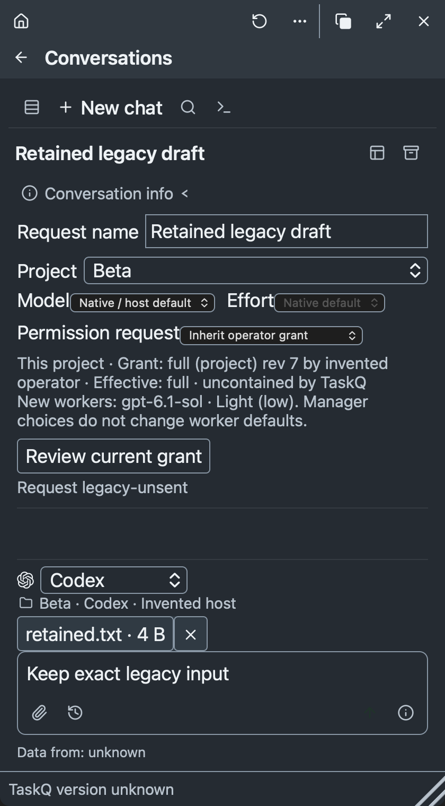

# Manager launch choices — #2165

Manager drafts retain project, runtime, model, effort and permission requests. The request is immutable after Send; current operator authority still bounds launch. R9/R12/R13 and taskq.md §7 apply. The existing R1 Chat link owns the [canonical launch-choice detail](../../ai-workspace.md#launch-choices). It defines this task’s accepted behavior under R9/R12/R13; no existing Product rule or numbered principle changes.

## Acceptance and evidence

| Item | Implemented behavior | Evidence and limit |
| --- | --- | --- |
| A1 | Installed catalogs, exact model/effort pairs, separate read-only future-worker defaults | Codex cache and official model guidance map “gpt-6.1 sol light” to `gpt-6.1-sol` / `low`, shown as Light (low). Claude exposes installed aliases with native effort only. Antigravity uses exact `agy models` IDs. No host defaults or active attempts are changed. |
| A2 | Durable defaults and per-runtime selections; grant revision fence at Send and launch | Real Rust file-backed persistence test preserves input/files and immutable request bytes after reconciliation. Browser tests cover New, reload, switching and stale-grant refusal. No production preferences are migrated. |
| A3 | Compact labelled native runtime select with bundled selected-provider icon | Browser keyboard typeahead, selected identity and full names pass. Real Antigravity 1.4.12 creates a disposable conversation and returns the exact marker; supported native continuation remains sandbox-blocked below. |
| A4 | Inherit, contained Workspace and uncontained Full/bypass requests | Policy tests prove narrowing, stale-revision refusal, Full refusal without a Full grant and unchanged operator-store bytes. Selected-request effective enforcement is shown separately from the original grant. Unsupported containment refuses. |
| A5 | Retained drafts/files/receipts, no uncertain replay, independent review and native layout | Existing Conversations browser suite and new launch browser suite pass with invented IPC. An isolated, invisible native WKWebView renders the actual bundle at 1000×760 and 420×760 without horizontal overflow. These are fixture layout checks, not installed/native launch acceptance. Native same-session recovery is unverified. |

## Before and after

- On the original JavaScript, New selected the first project (`fixture-alpha`) instead of saved `fixture-beta`; the persistence reproduction failed. The same browser check now restores the saved project/runtime/model/effort/request and never sends during switching or recovery.
- The native AgentQ Report uses `ok` for successful Antigravity output. The parser first reported `failed: ok`; its unchanged success assertion now passes with correct mapping.
- A native resume requested `3a99c16e-ce0e-4c3b-abad-48ca5580a989`. Antigravity warned that the conversation was missing, ignored `--conversation`, and returned `1413f0a0-698b-4ef3-83c1-a4011e048e23`. Exact-session verification failed. That unintended disposable copy received only the bounded marker prompt; no further input was replayed.
- The adapter now refuses missing/unreadable native conversation state before spawn and checks the exact startup ID before stdin. A retained regression proves that a different ID receives no input, including after a long retained intent. This proves the protective refusal, not successful native continuation.
- Runtime switching initially created an invalid grant fence for historical snapshots without launch facts, blocking Send in the existing Conversations suite. It now preserves legacy absence of choices; existing immutable Send, file and receipt assertions pass unchanged.
- Independent review found that late native success could overwrite a before-input startup refusal. A failing reproduction observed `success` for unsent input. A durable completed-write marker now fences both acceptance and outcome; the same test retains unknown after late SUCCESS.
- Headless Chromium on this Mac ignores Home/arrows even in a minimal plain select. Keyboard typeahead plus Enter selects both runtimes in the actual bundle. The test retains keyboard selection protection without claiming native desktop popup acceptance.

## Native observations

The owner authorized the isolated probe in note 6571782061. Existing sessions, workers, auth, grants and receipts were preserved; no production GUI was activated.

| Probe | Requested / observed | Result |
| --- | --- | --- |
| Direct isolated creation | `gemini-4-argon-low`, effort `low`; native `request-review`, no bypass | Native ID `3a99c16e-ce0e-4c3b-abad-48ca5580a989`, exact `TASKQ2165_NATIVE_OK`, SUCCESS, exit 0 |
| AgentQ adapter resume experiment before protective fix | Same requested ID/model/effort; isolated fixture Full grant; native `always-proceed` | Different native ID, exact `TASKQ2165_RESUME_OK`, SUCCESS, exit 0; exact-session assertion FAILED |
| Native state persistence | Write native conversation database; expected runtime-state write | Observed `operation not permitted`; sandbox-blocked. Durable same-session continuation/restart is unknown. |
| Native renderer fixture | Actual bundle, invented project/catalog/grant data, nonpersistent WKWebView | 1000 and 420 widths: selected Codex, `gpt-6.1-sol`, Full request, no horizontal overflow. Representative narrow capture below. |

The Full fixture is local test policy, not a live operator grant. Native `always-proceed` does not prove filesystem authority beyond the inherited outer boundary. Raw diagnostics stay local; public evidence names semantic path categories rather than private paths. Native DB persistence failures are not a passing containment test or an owner permission question.

## Verification

Development checks: `cargo test --locked --bin taskq conversations::tests` (19 pass), `runtime::choices::tests` (3 pass), `runtime::owner_stream::tests` (2 pass: stream identity, completion and no-input guards), `dialogue::tests` (12 pass, 1 existing ignored native case); `npm run build`; `node tests/manager-launch.browser.cjs`; `node tests/conversations.browser.cjs`. File-backed tests use an isolated installation and invented operator grants. No paid probe belongs to the regression suite.

The first canonical run refused a redundant Product summary addition because the task does not name that rule ID. The redundant summary was removed; the accepted launch detail stays in the already linked canonical Chat document. The canonical gate reruns because that first run failed, after the required pre-push rebase. Its result and exact candidate SHA are recorded on the task/PR. GitHub publication still requires green merge-result `merge_group` CI (§7/R12).

Independent source review checked catalog truth, permissions, launch ownership, switching, persistence and no-replay. Its concrete corrections include Report success mapping, removal of invented Claude effort pairs, selected-request access display, and retained real persistence/file tests. Final independent source review found no further functional blocker after the durable write fence. A concurrent filtered Cargo invocation collided in the macOS signing runner; the writer then reran it sequentially: all 12 dialogue checks passed, including the new late-success regression. No protection was relaxed.

## Visual review

The representative capture uses the native macOS renderer with invented data. Visual inspection at both widths confirmed visible controls, selected model, grant/request distinction, wrapping and no clipping. It does not qualify production GUI interactions or real grants.

## Legacy unsent draft correction

The reviewer reproduced a retained unsent draft without `choice`: Model, Effort, Permission request and grant review were absent until a runtime switch. The new legacy case in `tests/manager-launch.browser.cjs` failed on the original bundle with `0 !== 1` for the Model control, then passed on the corrected bundle (§7 step 4, R9/R12/R13).

The renderer now derives native-default choices for display without assigning them to the draft. Opening the old draft leaves its runtime and stored choice absence unchanged. Explicit Review current grant saves the current fence; it preserves the native defaults, project, text and retained file. Restoration and review dispatch no Send, reply or reconciliation. Existing persistence, switching, stale-grant and no-replay assertions remain. The existing Conversations browser suite also passes unchanged, retaining its immutable-input, receipt, file and recovery protections.

Independent read-only review cleared the render-only fallback and confirmed that sent/request records still exclude launch controls. The new legacy fixture itself is unsent and has no delivery receipt; it does not independently qualify uncertain native delivery or recovery.

An isolated nonpersistent WKWebView rendered the corrected bundle with the legacy fixture at 1000×760 and 420×760. Both read back Codex, native-default model and Inherit permission, with no horizontal overflow. Visual inspection confirmed all three controls, the grant/effective explanation, review button, retained file and composer without clipping. No production window was activated. These captures prove fixture layout only; the native continuation limits above remain unchanged.

