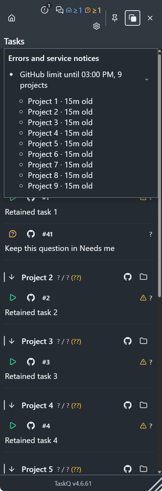
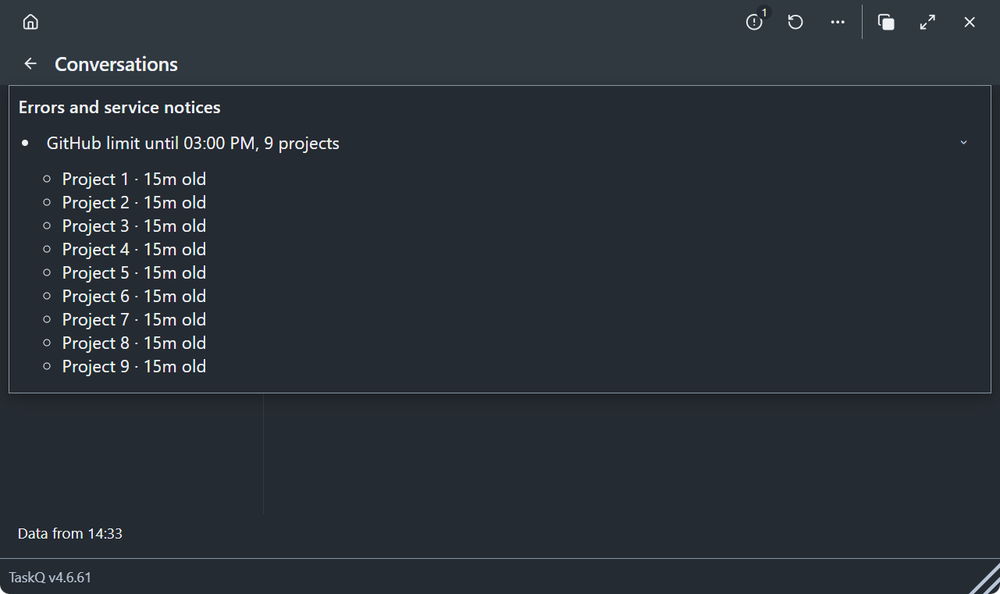

# Steady errors-list evidence

[Owner request and acceptance](https://github.com/taskqorg/taskq/issues/2351) · [surface inventory](../../errors-surfaces.md) · [M14](../../menu.md#errors-and-service-notices).

Baseline: `7edc9b21cfbeb493d503babe23ffbf85d7ce2077`. Implementation: `e8ee2656bad81f162699a0147fbc3299a4411c17`. The final evidence update changes no implementation code. Native captures followed the single rebase onto origin/main. They used an empty temporary installation and the invented `tests/fixtures/errors.js` state; no board, service policy, worker or owner session was changed.

## Failure before, pass after

`node tests/errors.browser.cjs` on the baseline failed at `one steady header errors icon`: actual `0`, expected `1`. This was recorded before implementation. The new nine-project fixture uses the service's canonical `rate limit: board requests paused until ...` error, with differing project/operation prefixes and the message collector's derived incomplete-source reasons.

The same regression now passes in Chromium: one cause and one count; nine expandable project names; task and Conversations rows retained; host total 9 labelled Last known with 15m age; cold open preserves the dated source; adding independent errors does not increase content height; a successful refresh removes the cause without acknowledgement; the question remains in Needs me. The 320px/200% text case retains Back, Close and the errors control. Independent causes remain distinct.

`node tests/errors.test.cjs` protects provider/server separation, notice-only pauses, structured diagnostic text, unknown ages, successful-empty recovery, board identity, missing-identity retention for the same root, and the freshness flags that continue refusing stale writes. The existing tray host and atomic-refresh checks pass. The atomic-refresh harness now includes the header because that is where persistent faults appear; its batching, recovery and no-false-health assertions remain.

`node tests/conversations-stable.browser.cjs` passes in Chromium and WebKit: notice changes preserve reader/composer geometry, editor node, focus, selection, IME, drafts and source fences. Its diagnostic assertions follow the new header live region; the full-text, structured-reason, receipt-recovery and no-replay protections remain. The existing declutter, Needs me/read, partial-project and sticky Home instruments also pass. The exploratory legacy shell instrument reaches obsolete selectors after its Back/Close boundary; it is unchanged. The task regression directly covers the affected 320px/200% navigation boundary. The partial-project check now opens the error list and checks both the diagnostic and affected project, retaining its loaded-count and unknown-only assertions.

## Native Windows WebView2

Commands, each with a separate output directory and the same temporary installation:

```text
cargo +stable run --locked -- tray --snapshot docs/design/evidence/2351/errors --route errors
cargo +stable run --locked -- tray --snapshot docs/design/evidence/2351/errors-conversations --route errors-conversations
```

Both exited 0 and each captured dark/light 16px states. The review set below contains two dark screens, one for each changed native surface. The unselected theme duplicates are omitted. Native executable SHA-256: `a45bb0f0ea15721ed0085b2873a3d00ca0356b7f417de13457846c2e1da67e15`.

Direct invocation of the development EXE first exited `0xC0000135` before rendering. Cargo's documented development launch path supplied the DLL search paths and both captures passed; no loader code, installed runtime or global PATH was changed. This is native WebView2 rendering evidence, not installed-release or macOS qualification. Reset time follows the host locale/time zone; the fixture reset is `1970-01-03T08:00:00Z`.





## Acceptance mapping

| Item | Evidence |
|---|---|
| A1 | Spec-first Product/M2/M3.1/M3.22/M14 edits and owner approval on the task; R13 rule gate passes. No numbered R rule was amended; R6/R12 freshness and action checks remain. |
| A2 | Linked surface inventory records keep/move/remove for tray, workspace, Conversations, Reports, shell and their shared dashboard/notification paths. |
| A3 | The same nine-project fixture failed before and passes after; native list expands to all nine names. |
| A4 | Warm/cold snapshot regression retains rows and dated host totals; distinct-error count cannot grow the page; native render inspected. |
| A5 | Successful observation clears the cause; the question stays in Needs me; existing source/receipt tests retain decision protection. |
| A6 | The two native screens above, also attached in the result archive. |

The first full gate found one obsolete Rust source-literal assertion (`HTML.contains("Settings unknown:")`); the other 991 unit cases passed. The corruption test retains its unknown-state, original-byte preservation, backup and successful-save checks. The browser regression now verifies the same corruption/save failure at the header, including readable announcements, survival through polling and receipt-based clearing. The display-model cause assertion also follows the header, retaining affected-project identity and loaded counts. All Node component checks pass. No data protection was removed.

The full canonical gate `python scripts/check.py --base 7edc9b21cfbeb493d503babe23ffbf85d7ce2077` passed on `dd587d23643ff7274a52503869dbcb785ddb2a68` in 586.125s: 992 Rust unit cases and 21 integration cases passed (47 explicitly ignored), offline selftest, Node checks, artifact scripts and changed browser instruments passed.

A final bridge-path probe then reproduced an `aiError` reaching the workspace controller with header count 0. The bridge fix forwards AI/workspace/AgentQ error notices and their explicit null readbacks to the same list in both windows. Its browser regression passed, followed by the canonical web-only gate `python scripts/check.py --base dd587d23643ff7274a52503869dbcb785ddb2a68` on `e8ee2656bad81f162699a0147fbc3299a4411c17` in 225.140s (11 Rust model cases, all Node/artifact checks and the changed browser check). The earlier full Rust/integration evidence remains applicable: no Rust implementation changed in this follow-up. The native captures and executable hash above are from this final implementation.

Local contract lint remained unknown because the checker's pinned specq checkout was absent; CI runs that lint. Documentation-only validation of this final evidence update is recorded on the task/PR. R12: Linux/macOS and merge-result CI remain separate from these Windows observations; publication still requires green `merge_group` CI under §7.
