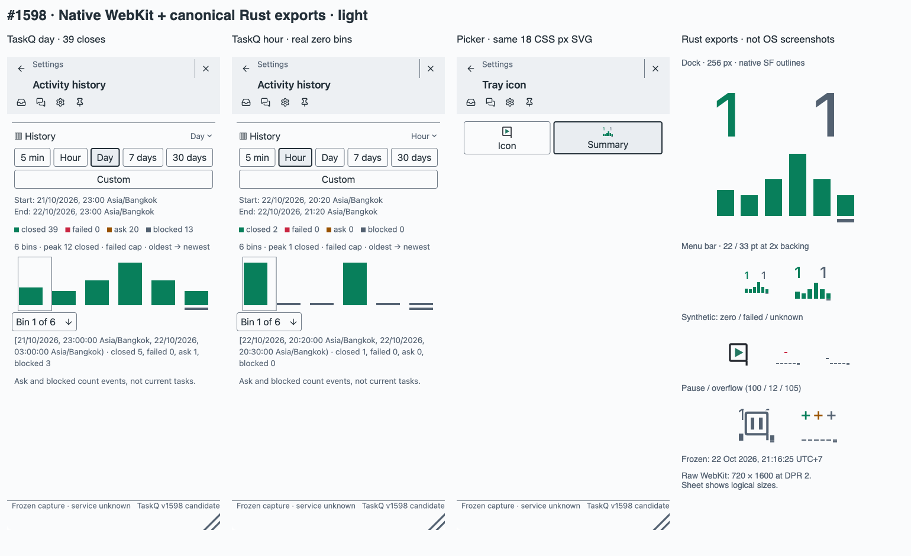
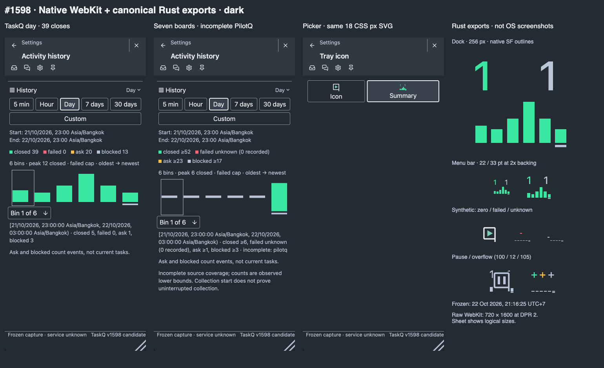
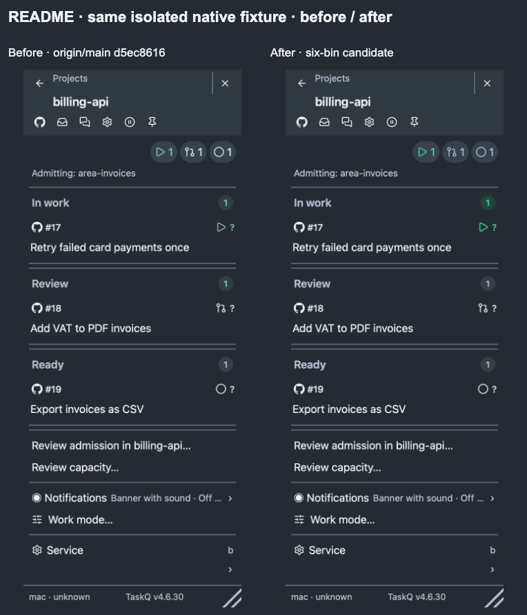

# #1598 native icon candidate

Status: implemented; the owner [accepted the visuals, including existing pause masking](https://github.com/taskqorg/taskq/issues/1598#issuecomment-6346651808) (A8). R13 amends Product and the linked I1–I6, R-UI4/R-UI5, M1/M6 and Custom compatibility pages. R8/R12 and § 7 keep source checks, native rendering, publication and installation separate.

## Owner review

Three sheets contain ten panels: six selected frozen native WebKit views, two native README before/after frames and two panels of canonical Rust raster exports. The export panels are explicitly **not OS menu-bar/Dock screenshots**. Frozen native frame files retain their original 720 × 1600 backing pixels; their sheets display 360 × 800 logical size. The README pair retains the same isolated project fixture.

[Light sheet](review-light.png) · [Dark sheet](review-dark.png) · [README before/after](readme-before-after.png)

Checked visually: six separated columns; equal quantities have equal heights; zero ticks differ from incomplete mid dashes; current-bin underline; native SF counter ink, 18 CSS px vector picker, fixed failed cap and fixed-width overflow. Active counters are uncropped. Pause retains the existing gray-data/cleared-square Q overlay, including its masking of underlying data; its appearance is part of the owner review, not a new pause policy.

## Source and scope

- Frozen source: [approved visual decisions](../../../reviews/visual-decisions.md), captured 22 October 2026 at 21:16:25 Asia/Bangkok. No activity was invented for the real examples.
- TaskQ day: closed **5 / 4 / 7 / 12 / 7 / 4**, peak 12, total 39. TaskQ hour: **1 / 0 / 0 / 1 / 0 / 0**, total 2. The seven-board aggregate marks PilotQ coverage incomplete in the first five bins; those values never set peak.
- Current frozen counters: Work 1, Ask 0 hidden, Ready + Blocked 1. The fixture adapter maps recorded `number` to snapshot `n`; its missing mapping initially collapsed task identities and left the counter row empty. Visual inspection caught it; the retained assertion now requires `[1, 0, 1, 0]` current counts.
- Zero peak, failed, unknown and overflow examples are explicitly synthetic. No failed event exists in the real capture. Unknown zero observations are labelled, not asserted to be complete zero totals.
- macOS 27.0.1, arm64; native WebKit at DPR 2; numeric outlines from `.AppleSystemUIFontMedium`, 9 pt, weight 500. The Swift instrument uses a nonpersistent WebKit store and the actual bundled page with Rust-generated frozen state. It runs no board or service action.
- [Manifest](manifest.json) pins source blobs, the bundled page and every review image. Current frame source: [capture.swift](../../../../tests/fixtures/icon-history/capture.swift); canonical inputs: `tests/fixtures/icon-history/*.json`.

## Verification

- Native surfaces reuse the published picker SVG and its observation time; crossing a bin boundary cannot make native and web graphs use different frames. The final focused icon/history/frozen-fixture checks pass after this wiring change.
- Before: twelve source bins, width rebinning, stacked event heights and separate Rust/JS color/geometry tables. After: real day/hour/incomplete inputs pass through one six-bin SVG; only complete-coverage closed counts set height.
- `icon::tests::six_columns_keep_quantity_marks_palette_and_device_bounds`: approved palette, zero peak, failed/unknown/ongoing marks, counter ink/overflow, blocked inclusion and paused gray identity pass.
- `tray::tests::approved_real_history_fixtures_use_one_six_bin_svg`: event identities, half-open bounds, real counts, missing sources, canonical browser/native chart groups and frozen counter identities pass.
- `node tests/tray-history.browser.cjs`: six original SVG groups, exact/incomplete detail, click/keyboard selection, refresh identity, themes/DPR, zero visibility and picker/Custom removal pass.
- Native WebKit: all eight frozen views captured successfully; six are retained in the bounded review set. The ordinary isolated `taskq tray --snapshot` also completed its icon/project matrix; temporary fixture data never changed the installed service.
- `python3 scripts/check.py --base origin/main`: **sandbox-blocked**, not PASS. After rebasing: Rust 479 passed, 18 host-authority failures under the worker context, 34 ignored; gate 200.939 s / 900 s. Explicit refusals include host install, policy edits and Stop. Permissions and assertions were not changed; integration tests were not reached. Publication still requires green `merge_group` CI.
- All Node component checks pass. A dependent source-provenance hash failed after the approved palette/document change; its input hash was refreshed with the assertions retained.
- Isolated offline selftest: 97 golden traces and formats pass; staged capture commits; board read intentionally unknown.
- `docs/shots/update.sh` completed on macOS 27.0.1 from `66237b3f`; the actual status-slot export is 34 pt at DPR 2 (68 × 68 px). The sheets also show the approved 22/33 pt reference exports.

Recreate canonical fixtures with `TASKQ_ICON_EVIDENCE=tests/fixtures/icon-history cargo +stable test --locked --bin taskq tray::tests::approved_real_history_fixtures_use_one_six_bin_svg`. Normal tests compare the saved bins, peak, palette and chart groups against the current renderer. Then run `npm run build`, compile `tests/fixtures/icon-history/capture.swift` with `swiftc`, and pass the repository root and a new output directory to that instrument. Passing size-matrix PNGs are not committed as extra review screens.

The accepted images remain unchanged after rebasing onto `dd8dcf3b`; renderer, tray, web sources and bundled-page hashes are identical. The `src/main.rs` source pin now includes upstream lifecycle changes outside the rendering path. The original README capture receipt remains tied to its captured source commit.

Open under R12: Windows native appearance/slot qualification; real OS menu-bar translucency/notch placement and Dock presentation. Source/native WebKit/export evidence does not qualify those shell effects. No installation, service, queue or runtime-policy change was made by this task.
