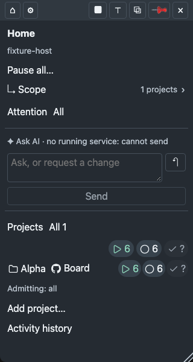
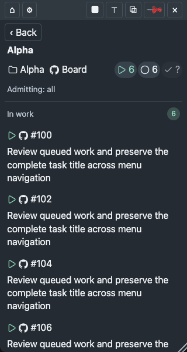
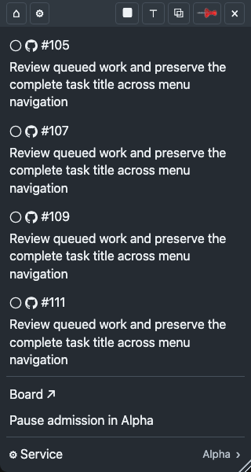
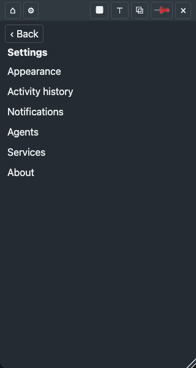
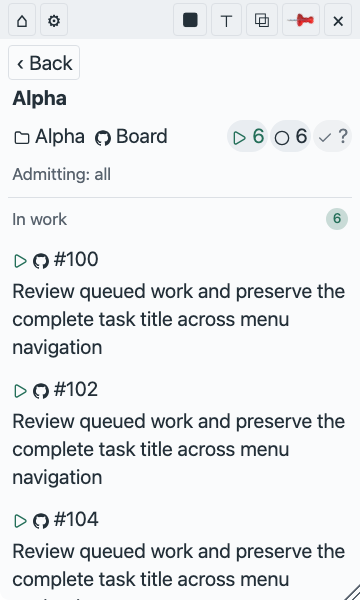
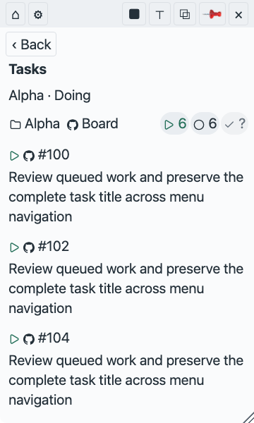

# Menu UI rules and baseline review

Approved TaskQ design targets under [R13/Product](../../taskq.md#product).
The [owner answer](https://github.com/taskqorg/taskq/issues/1348#issuecomment-6288254561)
approves all proposed targets, including view-only multi-select, with implementation
separate. These checks guide later menu pages and modules; they do not claim shipped
behavior or change runtime authority, permissions or publication gates.

## Baseline and scope

Reviewed source: `eba6209bfc58839b34c0ec6651aee15ece2a603c`.
The actual tray bundle rendered in Chromium 156.0.8078.4 with invented data,
without a native bridge: Home, Settings, Project, scrolled Project and Doing
filter, dark 16 px at 320×600 and light 20 px at 360×600.
All six screenshots were visually inspected. These are browser observations,
not installed-release, WKWebView, WebView2 or live-board acceptance (R12).
The simulated platform selects Windows UI branches; it does not prove Windows.

Reproduce from the repository root with the existing Playwright setup:

```sh
npm ci --ignore-scripts
npm run build
node docs/design/evidence/1348/capture.cjs
```

[Measurements and source identity](evidence/1348/observations.json) accompany
the [capture instrument](evidence/1348/capture.cjs). The instrument is research,
not a new CI gate. It ignores outbound bridge messages; no action is applied.
The fixed browser viewport does not reproduce native content-fit resizing.
Do not infer a native whitespace or clipping defect from that viewport.

## Standards and interpretation

Sources checked for this investigation:

- [WCAG 2.2](https://www.w3.org/TR/WCAG22/) provides testable web accessibility criteria.
  This review does not claim conformance.
- [W3C target-size guidance](https://www.w3.org/WAI/WCAG22/Understanding/target-size-minimum)
  distinguishes the AA 24×24 CSS px minimum and its exceptions from the
  enhanced 44×44 target. Do not call 44×44 a universal desktop AA requirement.
- [Microsoft back navigation](https://learn.microsoft.com/en-us/windows/apps/develop/ui/navigation/navigation-history-and-backwards-navigation)
  recommends a persistent top-left Back location and history-based navigation.
- [Apple buttons](https://developer.apple.com/design/human-interface-guidelines/buttons)
  informs recognizable action labels and tooltips. Its full page was not
  extractable in this research; no Apple-specific numerical threshold is claimed.
- [W3C checkbox pattern](https://www.w3.org/WAI/ARIA/apg/patterns/checkbox/)
  describes independent selections, Space activation and partial group state.

TaskQ's existing [visual dimensions](visual-style.md#geometry-and-type) remain
the product reference: 32 px fine-pointer row height and 44 px coarse-pointer
target height. CSS px, native pt and physical device pixels are not interchangeable;
native scaling needs separate evidence. A square 32/44 target for every control
below is an approved target clarification; implementation remains separate.

The approved [app UI v2 profile](ui-rules-v2.md) extends these checks with shared
navigation, interaction and state rules. This checklist keeps its IDs and the
source-pinned baseline below; the v2 preservation map records every mapping.

## Checklist: 28 rules

E = existing project/shared reference, used here as a check without redefining it.
P = TaskQ acceptance target approved in #1348 (original proposal identifier).
An E design target still needs implementation evidence; it is not a shipped claim.
The source column points to the canonical rule or the rationale for a proposal.

| ID | Basis | Check | Source |
|---|---|---|---|
| UI01 | P | Back occupies the leading header slot on every non-root route; its position changes by ≤1 CSS px while scrolling. | [Microsoft Back](https://learn.microsoft.com/en-us/windows/apps/develop/ui/navigation/navigation-history-and-backwards-navigation) |
| UI02 | E | List → detail → Back restores route, expanded groups and scroll position; refresh preserves the route. | [M8](menu.md#m8-implementation-boundary) |
| UI03 | P | One header contains Back, current route identity and window actions; at 320/360 px and 14/16/18/20 px, no overlapping hit rectangles. | [D2, stable adaptation](https://github.com/taskqorg/specq/blob/d496acf9365edfe1c11132f363ae5aaa7573e1f6/design/operator-ui.md#stable-adaptation) |
| UI04 | E | Board sits beside project identity; task, session and PR targets open directly and independently. Inspect every destination. | [D-A2](operator-ui.md#acceptance), [M3](menu.md#m3-navigation-and-tasks) |
| UI05 | P | Fine-pointer controls have ≥32×32 CSS px hit rectangles; coarse-pointer controls ≥44×44. Measure actual hit boxes, not glyphs. | [TaskQ dimensions](visual-style.md#geometry-and-type), [target guidance](https://www.w3.org/WAI/WCAG22/Understanding/target-size-minimum) |
| UI06 | P | Smaller targets pass WCAG 2.5.8 only through a documented spacing, equivalent, inline, user-agent or essential exception. | [WCAG 2.5.8](https://www.w3.org/TR/WCAG22/#target-size-minimum) |
| UI07 | E | Every icon action has an accessible name, tooltip and visible focus; inspect all header actions. | [Icon inventory](visual-style.md#icon-inventory) |
| UI08 | P | Tab reaches every enabled action; Enter/Space activates controls appropriately; no keyboard trap. | [WCAG 2.1.1](https://www.w3.org/TR/WCAG22/#keyboard), [2.1.2](https://www.w3.org/TR/WCAG22/#no-keyboard-trap) |
| UI09 | P | Focus follows reading order and stays visible after navigation, scrolling and refresh. | [WCAG 2.4.3](https://www.w3.org/TR/WCAG22/#focus-order), [2.4.7](https://www.w3.org/TR/WCAG22/#focus-visible), [2.4.11](https://www.w3.org/TR/WCAG22/#focus-not-obscured-minimum) |
| UI10 | E | Destructive/lifecycle review names target and effect before confirmation; saved, pending and applied remain distinct. | [M5](menu.md#m5-admission-and-lifecycle) |
| UI11 | E | No repeated identity, destination or counter group unless it adds distinct context; count duplicates on each route. | [D4/D9](https://github.com/taskqorg/specq/blob/d496acf9365edfe1c11132f363ae5aaa7573e1f6/design/operator-ui.md#principles) |
| UI12 | E | Empty groups occupy zero rows; decisions and faults precede ordinary project lists. Check empty and failed fixtures. | [D-A7](operator-ui.md#acceptance), [D13](https://github.com/taskqorg/specq/blob/d496acf9365edfe1c11132f363ae5aaa7573e1f6/design/operator-ui.md#principles) |
| UI13 | E | Task titles wrap from the block's full left edge; identifiers remain legible at 320/360 px with 180-character titles. | [D-A1/D-A4](operator-ui.md#acceptance), [native matrix](ui-acceptance.md#native-matrix) |
| UI14 | E | Counter order stays stable; project summaries hide zero, task-list filter strips keep zero icons; unknown remains labelled. Check 0/1/12/100/1000 and partial data. | [Counter acceptance](task-counters.md#acceptance), [R6](../../taskq.md#r6-human-report) |
| UI15 | E | Outer inset 8 px, row horizontal inset 4 px, related gaps 4–6 px; sections use 6 px separation and one 1 px divider. | [Geometry](visual-style.md#geometry-and-type) |
| UI16 | E | Names and compact counter groups reuse aligned edges; 1/12/100 counts neither overlap nor stretch into unrelated whitespace. | [D2/D10](https://github.com/taskqorg/specq/blob/d496acf9365edfe1c11132f363ae5aaa7573e1f6/design/operator-ui.md#principles) |
| UI17 | E | Text settings 14/16/18/20 apply throughout; secondary text ≥max(12 px, 0.85×base); icon size remains independent. | [Geometry](visual-style.md#geometry-and-type), [D-A3](operator-ui.md#acceptance) |
| UI18 | P | Text resized to 200% loses no content or function; no horizontal scrolling at the 320 CSS px reflow check. | [WCAG 1.4.4](https://www.w3.org/TR/WCAG22/#resize-text), [1.4.10](https://www.w3.org/TR/WCAG22/#reflow) |
| UI19 | E | Text contrast ≥4.5:1 in both themes; state remains understandable without color. Measure composited colors. | [D7](https://github.com/taskqorg/specq/blob/d496acf9365edfe1c11132f363ae5aaa7573e1f6/design/operator-ui.md#principles) |
| UI20 | P | Essential control boundaries and state graphics have ≥3:1 adjacent contrast, subject to WCAG exceptions. | [WCAG 1.4.11](https://www.w3.org/TR/WCAG22/#non-text-contrast) |
| UI21 | E | Natural content fits without primary scrolling; overflow has one intended scroller and a reachable final control. | [U-A2/U-A4](ui-acceptance.md#hard-gates) |
| UI22 | E | Missing, stale, failed and empty data remain distinguishable; unknown never renders as zero or healthy. | [R12](../../taskq.md#r12-unverified-means-unknown), [R6](../../taskq.md#r6-human-report) |
| UI23 | E | Every effect shows pending, success by readback, failure and uncertain outcome; retry never silently duplicates it. | [M5](menu.md#m5-admission-and-lifecycle), [R4](../../taskq.md#r4-comments-move-the-queue) |
| UI24 | P | Non-focus status updates are programmatically announced without moving focus. | [WCAG 4.1.3](https://www.w3.org/TR/WCAG22/#status-messages) |
| UI25 | P | The top counter strip is the only state filter; no Filter disclosure or checkbox group. All eight states stay in order, zero is icon-only, unknown is `?`. Enter/Space toggles the focused capsule. | [K-A2/K-A6](task-counters.md#acceptance) |
| UI26 | P | Selected capsules have a visible outline and `aria-pressed=true`; cleared capsules have `aria-pressed=false`. All tasks in the same wrapping row shows the deduplicated open total across projects, excluding closed tasks, and clears project/state restrictions to show each project with nonzero counters and its tasks. | [K-A6](task-counters.md#acceptance) |
| UI27 | P | State capsule clicks set or clear selection; several states use OR within the current project scope. Zero selected states means no state restriction; Reset clears selection. Fixture results equal those set operations. | [TaskQ filter scope](../../taskq.md#5-commands) |
| UI28 | P | Filters are view-only; show selected states and matching count; Back preserves selection; zero matches offers Reset. No queue/focus write occurs. | [M4](menu.md#m4-request-interpretation-and-applied-state), [R9](../../taskq.md#r9-no-silent-changes-to-model-effort-or-permissions) |

UI25–UI28 use the owner decision in [#1438](https://github.com/taskqorg/taskq/issues/1438):
counter toggles replace the separate checkbox group. Empty selection removes the
state restriction. Admission focus, host capacity and board labels are unchanged.

## Observed menu findings

Each row has a screenshot, criterion, observed consequence and proposed remedy.
No fix was implemented, so there is no after-pass evidence. Findings retain their
pre-approval classification; proposal gaps are now approved implementation targets.
“Target gap” compares an existing design reference; “proposal gap” is not a
binding-contract violation.

| Finding | Evidence and criterion | Observation | Proposed fix |
|---|---|---|---|
| F1 · navigation target gap; UI01 specifies the remedy | [Project at top](evidence/1348/project-dark-16.png), [after scroll](evidence/1348/project-scrolled-dark-16.png); UI01, shared stable adaptation | Back moves from y=39.59 to y=-1050.41 when content scrolls 1090 px. Home remains accessible, but returning to the previous route requires scrolling or keyboard recovery. | Put Back and route identity in the fixed header; preserve existing history, scroll and disclosure restoration (UI02). |
| F2 · proposal gap | [Header and Back](evidence/1348/settings-dark-16.png); UI05 | At 16 px text, header targets are 27.59 px high and Back 30 px; Home is 25.64 px wide. They fail proposed 32×32. They do not automatically fail WCAG AA. | Add minimum hit dimensions without enlarging glyphs; reflow header actions if necessary. Keep emergency and close separate. |
| F3 · density target gap | [Project top](evidence/1348/project-dark-16.png), [bottom](evidence/1348/project-scrolled-dark-16.png); UI04/UI11 | Two Board links have the same destination; the lower full-width link adds a row after all tasks. Project name also appears in h1 and the adjacent summary. | Keep Board beside identity; consolidate the identity heading with the summary and remove the repeated bottom link. |
| F4 · empty-group target gap | [Home](evidence/1348/home-dark-16.png); UI12 | With no ask/failed/service faults, Attention still occupies a header row with All, followed by no attention items. | Omit the empty Home group; retain explicit “no questions or failures” when opening Attention directly. |
| F5 · proposal gap | [Doing filter](evidence/1348/filter-light-20.png); UI25–UI28 | Counter click opens one state; `taskFilter` is scalar and this route has zero checkboxes. Doing and Ready cannot be selected together. Existing single-state behavior is not a contract defect. | Add the approved, clearly labelled view-filter group; retain counter shortcuts and show selection/result count. |

F1 is produced by `src/tray-app.js` `draw()`: Back is inside `.content`.
F2 follows `.head button` padding and missing minimum dimensions in `src/tray.html`.
F3 follows `project()` plus `TaskqProjectBlocks.summary()`.
F4 follows unconditional Attention header creation in `home()`.
F5 follows `filteredTasks()` and `navigate()`'s scalar filter.
The resize grip is 18×18; UI06 exception applicability and pointer overlap were
not evaluated, so this is an inspection item rather than an asserted AA failure.













## Coverage and remaining evidence

Observed strengths: long task titles use the full width; Board is available near
identity; unknown Closed is “?” rather than zero; settings labels are readable.
These examples do not establish full accessibility or all-route compliance.

Measured/reviewed: UI01, UI03–UI05, UI11–UI13, UI17 and UI25, within the fixtures
above. UI14 has unknown and nonzero examples only. UI15/16 have source and visual
inspection, not a complete geometry audit. Other checklist items remain untested.
Keyboard history, screen readers, contrast ratios, 200% resize, coarse-pointer
targets, live receipts and native sizing still need focused evidence.
Do not mark them Pass from this report.

## Adoption and implementation boundary

The owner approved all targets in [answer 1](https://github.com/taskqorg/taskq/issues/1348#issuecomment-6288254561).
The 32/44 pointer distinction and UI25–UI28 view-only selection semantics are accepted.
R13/Product adopts this checklist; [Menu](menu.md), [visual dimensions](visual-style.md)
and [UI acceptance](operator-ui.md) link to its TaskQ checks. Shared principles remain
canonical in specq; the E rows are a review index, not replacement rules.

The original #1348 deliverable changed specifications only. Later implementation follows
the #1438 counter-toggle decision, preserving queue policy and admission scope. Re-run the affected checks against
the implementation candidate and retain these failing baseline observations beside the
new evidence. Native and accessibility acceptance remain separate under R12.
